# DivaWaste Textile — user manual

Every screen of the application, by workspace, with what it shows, what you can do on it and a screenshot taken
from the running application (demo data, re-captured on 5 October 2026 on the current interface). Screen labels are quoted in French, as they appear.

- To run the application and sign in: [DEVELOPER_RUNBOOK.md](DEVELOPER_RUNBOOK.md) and [TEST_ACCOUNTS.md](TEST_ACCOUNTS.md).
- To operate the SaaS itself: [PLATFORM_ADMIN_GUIDE.md](PLATFORM_ADMIN_GUIDE.md).
- Who may do what: [ROLES_AND_PERMISSIONS.md](ROLES_AND_PERMISSIONS.md).

## Contents

1. [How the product is organised](#1-how-the-product-is-organised)
2. [Getting an account](#2-getting-an-account)
3. [Common elements of every screen](#3-common-elements-of-every-screen)
4. [Client administrator](#4-client-administrator)
5. [Environment manager — daily operations](#5-environment-manager--daily-operations)
6. [Compliance](#6-compliance)
7. [Reports](#7-reports)
8. [Workshop operator — the `/m` application](#8-workshop-operator--the-m-application)
9. [Direction — read-only](#9-direction--read-only)
10. [Auditor / donor — read-only trail](#10-auditor--donor--read-only-trail)
11. [Provider workspace](#11-provider-workspace)
12. [Platform administration](#12-platform-administration)
13. [Status reference](#13-status-reference)

---

## 1. How the product is organised

| Workspace            | Who                                                                       | Starts at                                 | Navigation colour                                |
| -------------------- | ------------------------------------------------------------------------- | ----------------------------------------- | ------------------------------------------------ |
| Client workspace     | Textile companies: administrator, environment manager, direction, auditor | `/dashboard` (or `/lots` for the auditor) | Dark green                                       |
| Workshop application | Operators, on a phone or tablet                                           | `/m`                                      | Full-screen, large buttons                       |
| Provider workspace   | Collectors, transporters, recyclers                                       | `/provider/pickups`                       | Dark green, own menu                             |
| Back office          | Diva Software                                                             | `/platform/overview`                      | Dark blue, tag "Administration de la plateforme" |

The life of a waste lot, which the whole product follows:

```
Créé → Stocké → En attente d'enlèvement → Enlevé → Traité → Clôturé
(lot created)   (in a pickup request)     (loaded) (treated by the provider) (pickup closed)
```

## 2. Getting an account

### Registration — `/register` (public)

A company registers itself, as **Industriel textile** or **Prestataire**.

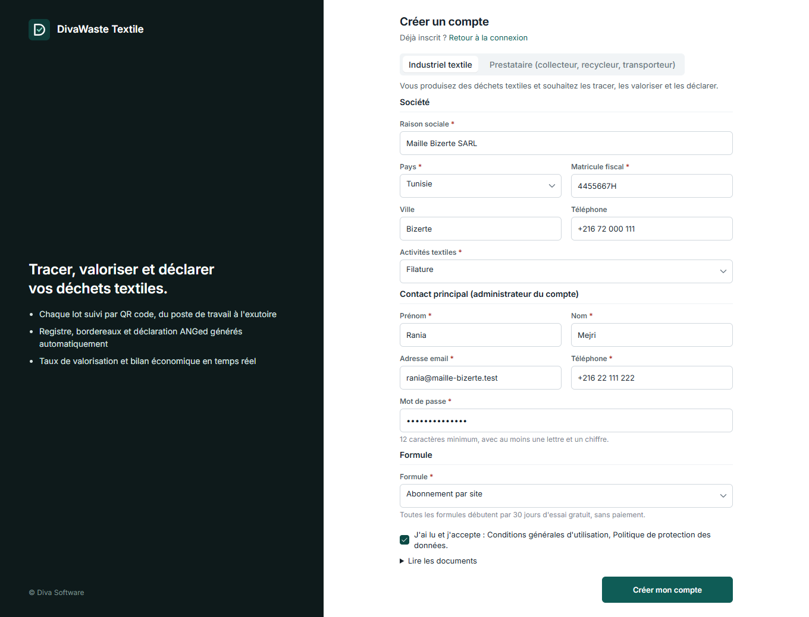

Required: company name, country, tax identifier (checked against the country's format), activities, the contact
(first name, last name, email, phone, password of 12 characters minimum), the intended plan, acceptance of the
legal documents. A provider also gives its activity and at least one accreditation PDF.

Then: confirm the email (link valid 24 hours) → wait for Diva Software's approval → sign in.

| Screen | When |
|---|---|
|  | Right after registration |
| 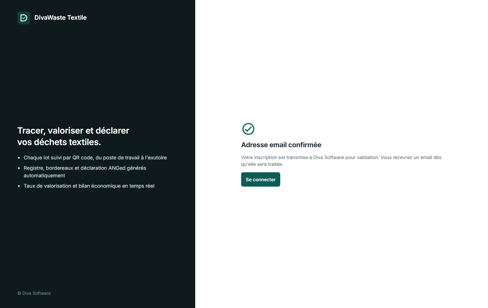 | After clicking the link |
|  | Signing in before approval |
|  | If the registration is refused (with the reason) |
| 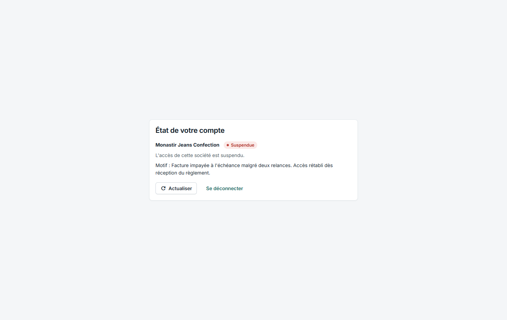 | If the account is suspended later (with the reason) |

### Invitation — `/invitation` (link received by email)

Colleagues do not register: the administrator invites them (see [Utilisateurs](#utilisateurs-et-rôles--adminusers)).
The link is valid 7 days; the person chooses a password and accepts the terms.

### Sign-in — `/login`

Email and password; a 6-digit code if two-factor authentication is on; the company if you belong to several.
Five wrong passwords lock the account for 15 minutes. "Mot de passe oublié ?" sends a reset link.

### First steps — `/onboarding`

A new client lands on an empty dashboard with the banner "Terminez la mise en route". The wizard lists four
steps and opens the real screen for each; it can be left and resumed.

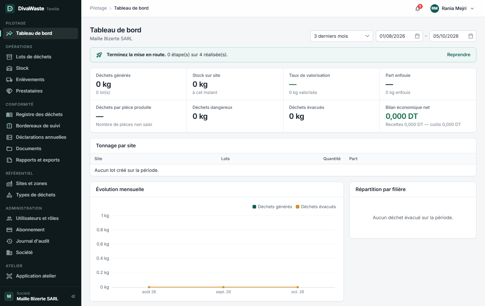


The first three steps, done for real by a new client: a site, its zones, a waste type from the catalogue.

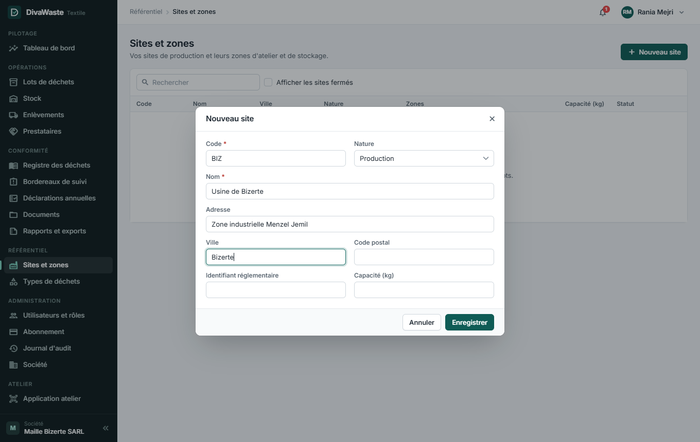
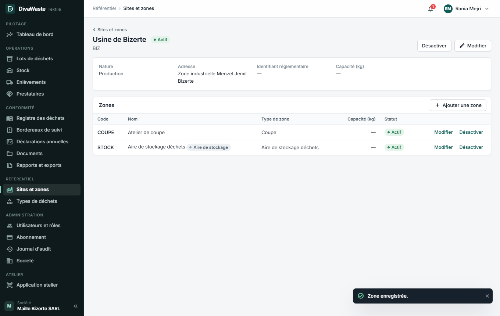
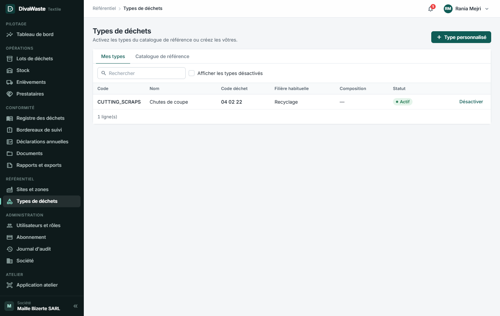

## 3. Common elements of every screen

- **Aide sur cette page**: most pages open with a blue box that explains, in a few sentences, what the page shows and
  how to use it. "Masquer" hides it; "Aide sur cette page" brings it back. The choice is remembered per page on the device.
- **Scrollbars** are wide and solid, with a visible track, on every list and on the page itself.

- **Navigation** on the left, grouped (Pilotage, Opérations, Conformité, Référentiel, Administration, Atelier). You
  only see what your role allows. The double arrow at the bottom folds it to icons.
- **Top bar**: where you are, the notification bell, your name (profile, security, sign out).
- **Page header**: title, one-line explanation, and the actions of the page on the right. The main action is the
  filled green button.
- **Filters** sit on one line above each list. A filter that is set is tinted green; "Réinitialiser" clears all.
- **Tables**: click a column title with arrows to sort; click a row to open it; the footer gives the count and
  the pages.
- **Messages** appear at the bottom right. A red field shows what is wrong under it.
- **Statuses** are coloured tags; their meaning is in [section 13](#13-status-reference).

## 4. Client administrator

Account: `amira@capbon.test`. Sees everything of the company *Textile du Cap Bon*.

### Tableau de bord — `/dashboard`

*Roles: client administrator, environment manager, direction.*

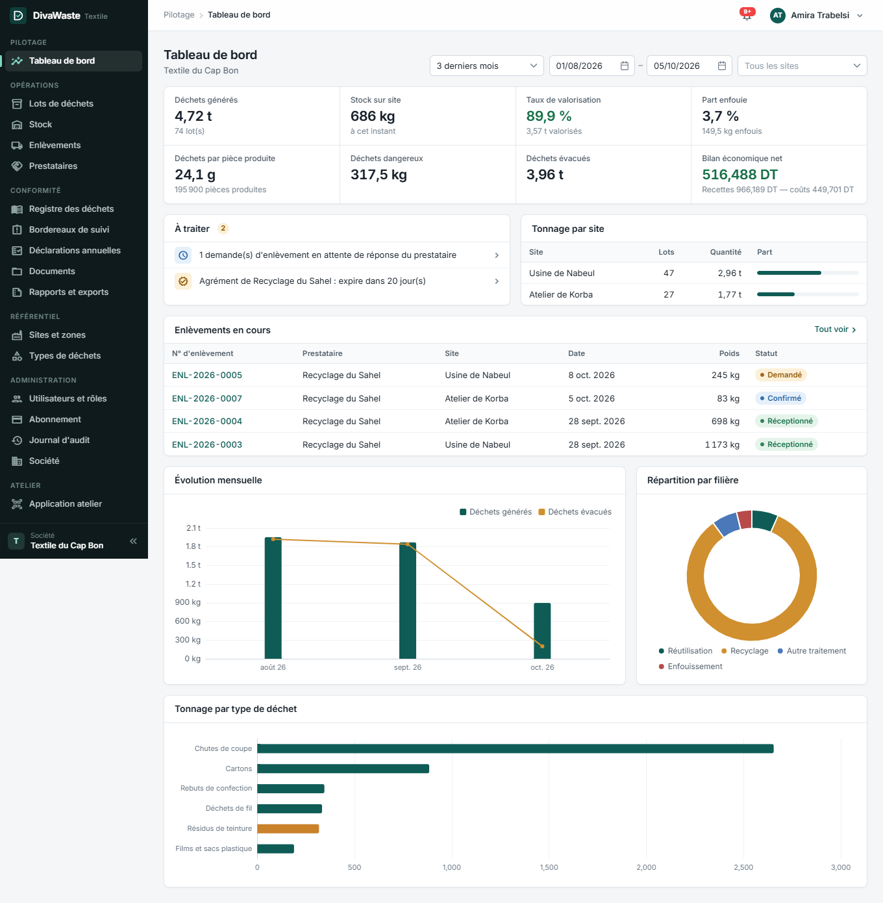

Filters (top right): period (this month, 3 months, year, 12 months, 3 years, custom dates) and site.

| Figure                     | Meaning                                                              |
| -------------------------- | -------------------------------------------------------------------- |
| Déchets générés            | Weight and number of lots created in the period                      |
| Stock sur site             | Weight present on site right now (not affected by the period)        |
| Taux de valorisation       | Share of treated waste that was reused, recycled or energy-recovered |
| Part enfouie               | Share sent to landfill (amber above 20 %)                            |
| Déchets par pièce produite | Waste divided by the pieces produced (entered in Rapports)           |
| Déchets dangereux          | Weight of hazardous lots                                             |
| Déchets évacués            | Weight that left the site in the period                              |
| Bilan économique net       | Revenue from sold waste minus treatment costs                        |

Then: **À traiter** (alerts: requests waiting for the provider, slips to sign, thresholds exceeded,
accreditations expiring — each links to the screen), **Tonnage par site**, **Enlèvements en cours**, the monthly
evolution, the split by treatment channel and the tonnage by waste type (hazardous in amber).

### Société — `/admin/company`

*Permission: company.update.* Legal details, address, logo (printed on reports), contact. Tax identifier and
country are fixed after registration.

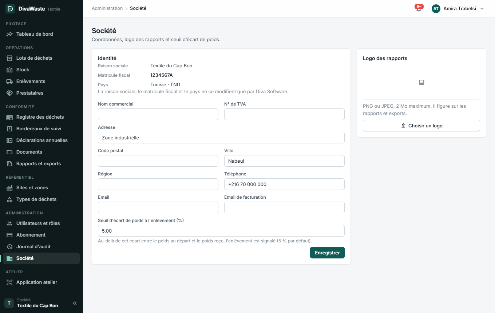

### Sites et zones — `/sites`

*View: sites.view. Change: sites.manage, zones.manage.*

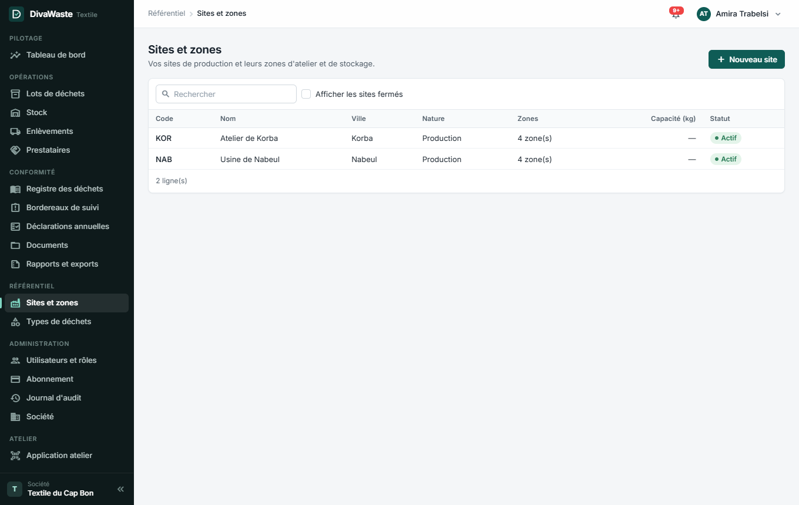

Search; "Afficher les sites fermés". **Nouveau site**: code (short, unique), name, nature, address, capacity.
Click a site to manage its zones:

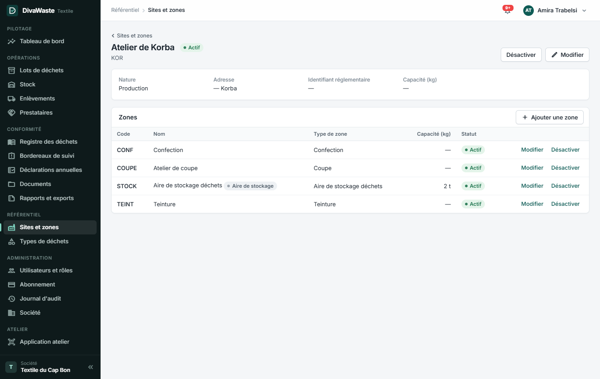
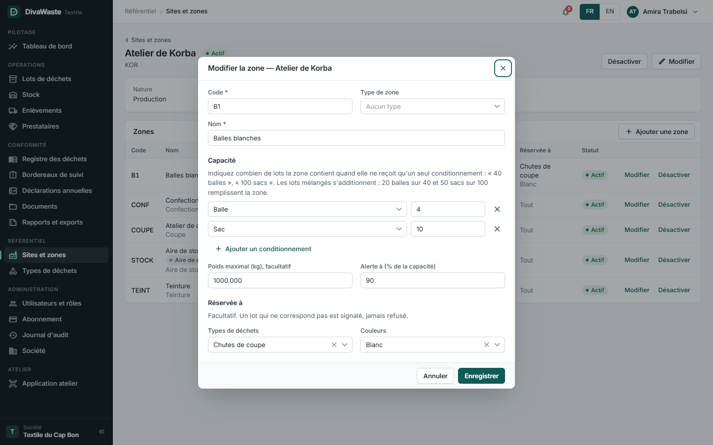

A zone has a code and a name. Everything else is optional:

- **Type** (cutting, sewing, dyeing, waste storage…). A zone of type "Aire de stockage" is where lots wait for a pickup.
- **Capacité**: how many lots the zone holds when it receives a single packaging — "40 balles", "100 sacs" — one line per
  packaging. Mixed lots add up: 20 bales out of 40 and 50 bags out of 100 fill the zone. A maximum weight in kg can be
  given as well; the higher of the two percentages is the one shown.
- **Réservée à**: the waste types and colours the zone is meant for. A lot that does not match is **reported, never
  refused**: a warning under the zone when the lot is created or moved, and "lot(s) hors affectation" on the stock page.
  In the workshop application, the types planned for the chosen zone come first.

Sites and zones are **deactivated**, never deleted: history keeps pointing to them.

### Utilisateurs et rôles — `/admin/users`

*View: users.view. Invite: users.invite. Manage: users.manage. Roles: roles.manage.*

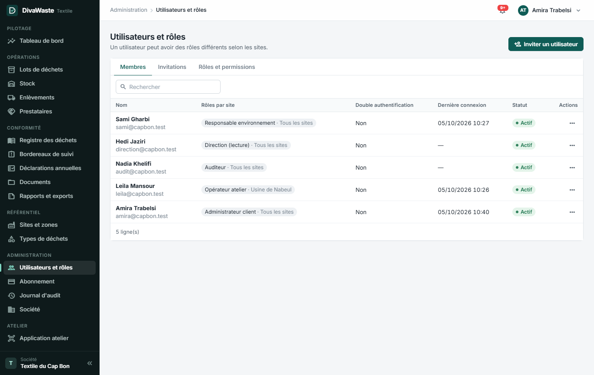

Tab **Membres**: name, roles per site, two-factor, last sign-in, status. The "…" menu: *Modifier les rôles*,
*Suspendre* / *Réactiver*, *Retirer de la société*.

**Inviter un utilisateur**: email, name, role, and the sites the role applies to (empty = all sites).

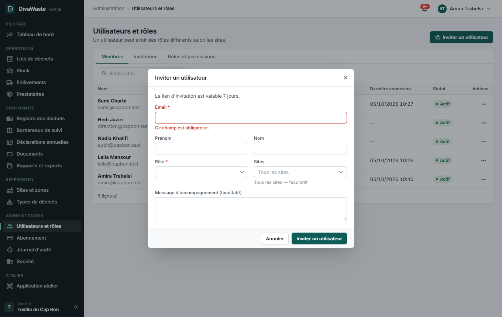

The invited person receives a link valid 7 days, chooses a password, accepts the terms, then signs in.

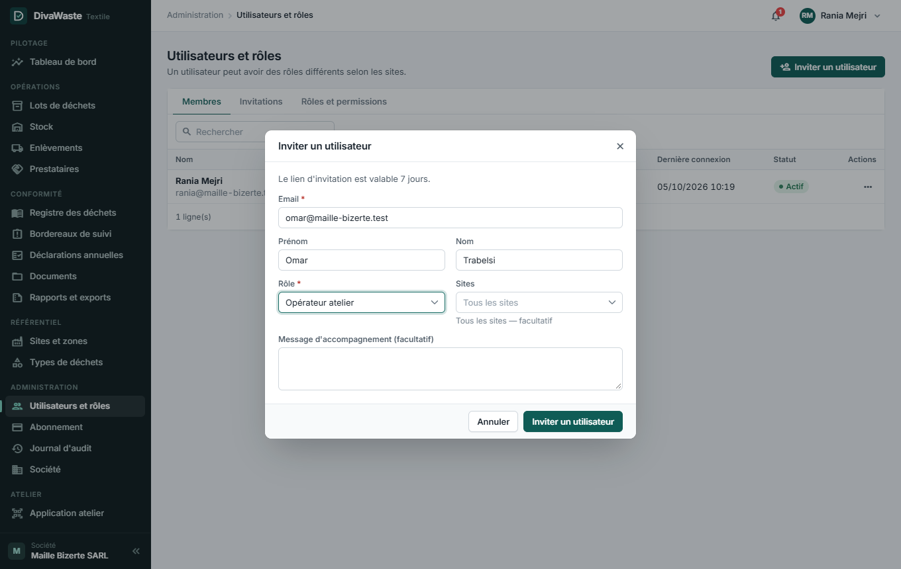
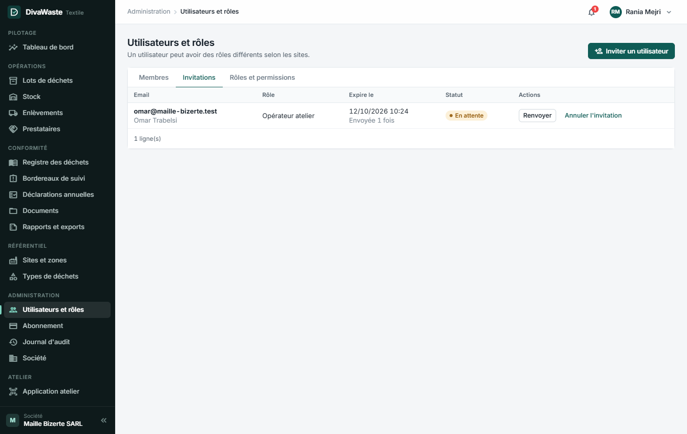
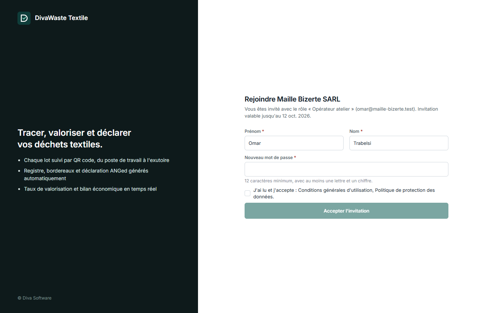
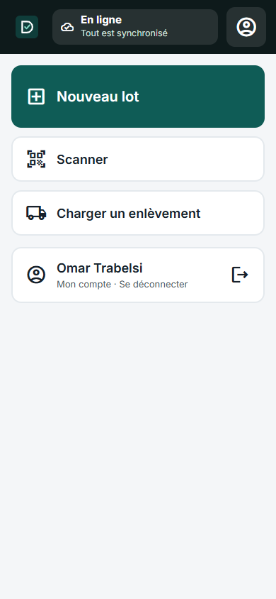

Tab **Invitations**: pending invitations, resend or revoke. Tab **Rôles et permissions**: the standard roles
(read-only) and your own roles, with their permissions.

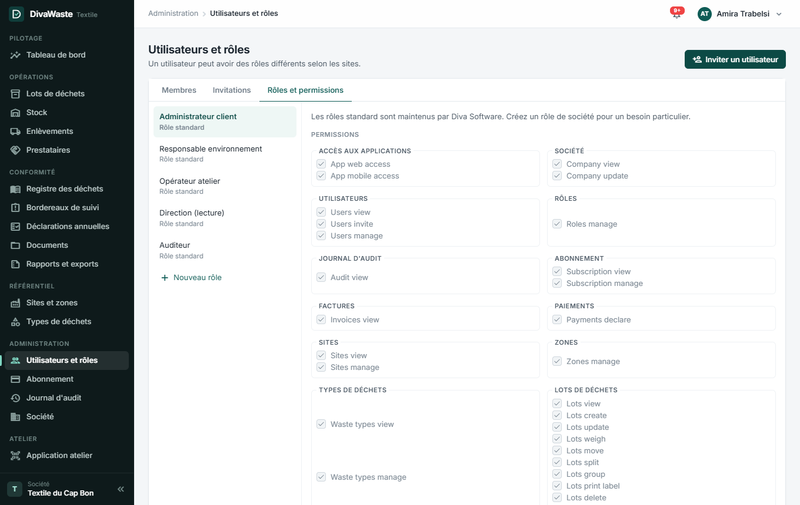

### Types de déchets — `/waste-types`

*View: waste_types.view. Change: waste_types.manage.*

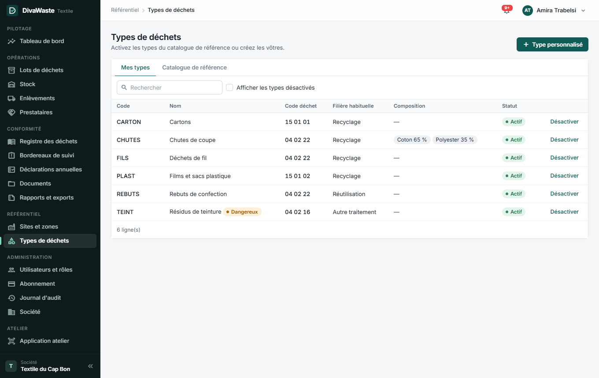

Tab **Mes types**: the types usable in lots. Tab **Catalogue de référence**: the platform's list; **Activer**
adds one to your types.

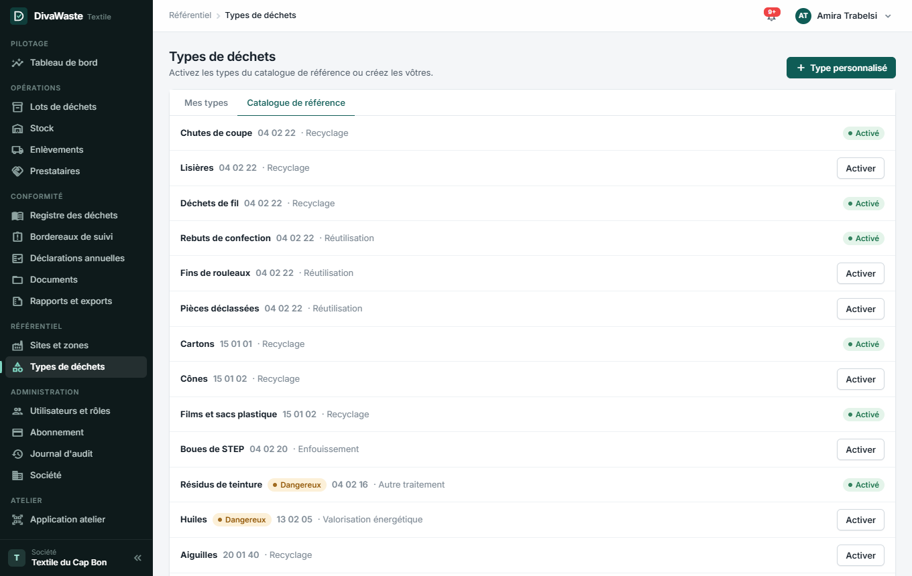

**Type personnalisé** creates your own: code, family, name, regulatory code, hazardous flag, tracking unit,
usual channel, packaging, colour, grammage, density, unit weight and default fibre composition.

**Couleurs** (third tab) lists the colours offered on lots, waste types, raw materials and zones, as swatches: the
defaults shared by everyone, then yours. The search box filters by name, code or HEX value.

- **Ajouter une couleur**: a name, an optional internal code, and an optional tint — chosen with the picker, typed as
  HEX (`#0F4C81`) or as three RGB values; typing one rewrites the other. A Pantone reference can still be typed by hand.
- **Teintes proches dans le catalogue** (in that form, **Chercher**): the five catalogue colours nearest to the tint,
  with their difference (ΔE, CIEDE2000: 0 = identical, about 2 = barely visible, above 10 = another colour). These are
  approximate suggestions computed from the screen colour, not official Pantone equivalences; your colour is not
  changed. **Ajouter à mes couleurs** adds the suggested colour beside yours.
- **Catalogue Pantone** (shown only when the platform has loaded a catalogue): browse it 60 colours at a time, search
  by reference or HEX, filter by collection (coated, uncoated, metallic, pastels and neons, skin tones, colours of the
  year). **Ajouter** puts the colour in your list; it keeps the reference and tint of the catalogue and you may rename it.
  The same reference exists in several collections (871-c is both coated and metallic): they are different colours.
- "…" on one of your colours: **Modifier**, **Retirer de la liste** (no longer offered; what carries it keeps it) or
  **Supprimer** (only while no lot, waste type, material or zone uses it).

The tints are unverified screen approximations and do not replace a physical colour guide.

**How a type is measured.** The unit of a type decides what its lots are declared and compared in: kg or tonnes = a
weight, pieces = a count, litres or m³ = a volume. **Mode de mesure** says how the figure is obtained (pesé, compté,
mesuré, estimé). A lot of a counted type is declared by its quantity; its weight is optional. Left empty, the weight
is computed when the type states the weight of one piece (or its density), and otherwise stays **non mesuré** — it is
never guessed, and pieces are never compared with kilograms.

Tab **Tolérances** — the gap accepted between what left and what was received, as a percentage of what left:

- A rule is for a waste type, a treatment channel, both, or every waste. The most precise one applies: type + channel,
  then the type, then the channel, then "Tous les déchets". Below all of them stands the percentage of the company
  settings (5 % unless you changed it), shown on the last line "Tout autre cas".
- **Seuil d'alerte**: above it the gap must be explained before the pickup is closed. **Seuil bloquant**: above it the
  gap must be accepted by a person holding "Accepter un écart au-dessus du seuil bloquant" (pickups.authorize_variance),
  with a reason. Either may be left empty. Nothing is ever rejected or altered automatically.
- **Écarts surveillés**: both ways, excesses only, or shortages only. The signed gap is always shown.
- **Nature de la règle**: an internal rule, or a regulatory requirement — which must name its text. No regulatory
  percentage ships with the application: enter the ones that apply to you.
- A changed rule applies to the next receptions. Receptions already recorded keep the rule applied to them, and every
  creation, change and deletion of a rule is in the audit trail.
### Prestataires — `/providers`

*View: providers.view. Partners: providers.partnerships.manage.*

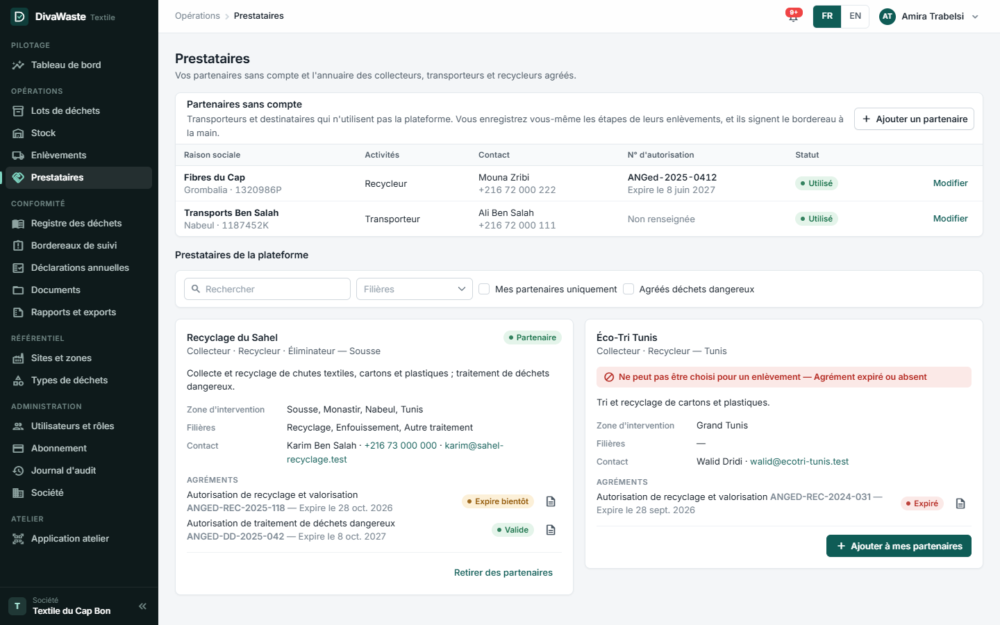

**Partenaires sans compte** (top of the page): transporters and receivers that do not use the platform.
**Ajouter un partenaire** records the legal name, the activities (transporter, recycler, eliminator — any
combination), the tax ID, the contact and, optionally, the authorisation number with its expiry date and whether it
covers hazardous waste. Such a partner is visible to your company only; the platform does not review its
authorisation. For its pickups you record the stages yourself and it signs the tracking slip by hand. A partner
you stop using is switched off ("Utilisé" unticked), never deleted.

When such a partner later opens an account on the platform and publishes its profile with the **same tax ID**, its
line says so and offers **Associer à ce compte**. The provider then becomes one of your platform partners: the next
pickups are sent to it through the platform and it signs itself. Pickups already recorded do not change, and the
record without an account can no longer be chosen. When the tax IDs do not match, **Associer à un compte** lets you
choose the provider yourself in the directory.

**Prestataires de la plateforme**: directory of approved providers: activities, description, area, channels,
contact, accreditations with their validity. Filters: search, channel, "Mes partenaires uniquement", "Agréés déchets dangereux".
**Ajouter à mes partenaires** makes a provider selectable in your pickup requests. A provider whose accreditation
has expired shows a red notice and cannot be chosen.

### Abonnement — `/admin/subscription`

*View: subscription.view. Manage: subscription.manage.*


Current plan and its status, trial end or current period, sites used / included. **Changer de formule**: choose
a plan and a number of sites; this sends a request to Diva Software, which activates it at the agreed price.
**Résilier** stops the subscription at the end of the paid period. **Factures**: number, dates, total, paid,
status, PDF, and **Déclarer un virement** (amount, bank reference, date) once you have paid by bank transfer.

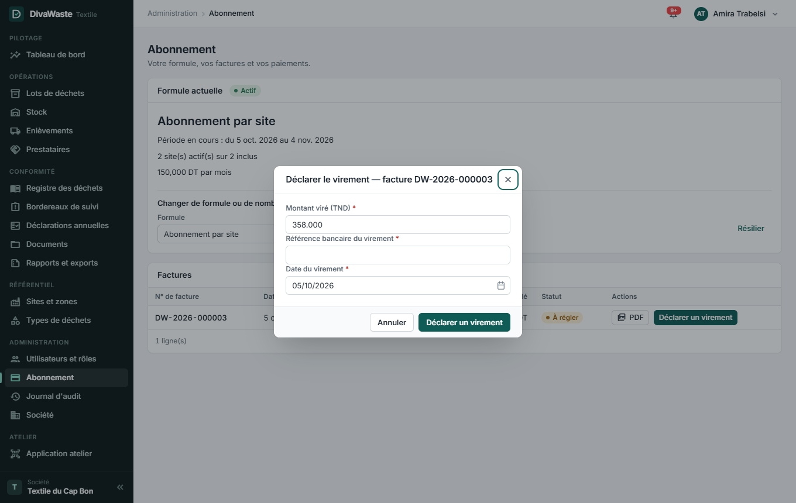

### Journal d'audit — `/admin/audit`

*Permission: audit.view.* Every creation, change and deletion in the company, with author and source. Filters:
action, object, dates. Click a line to see the values before and after.

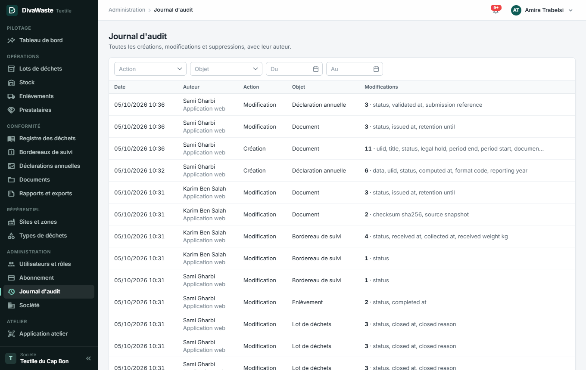
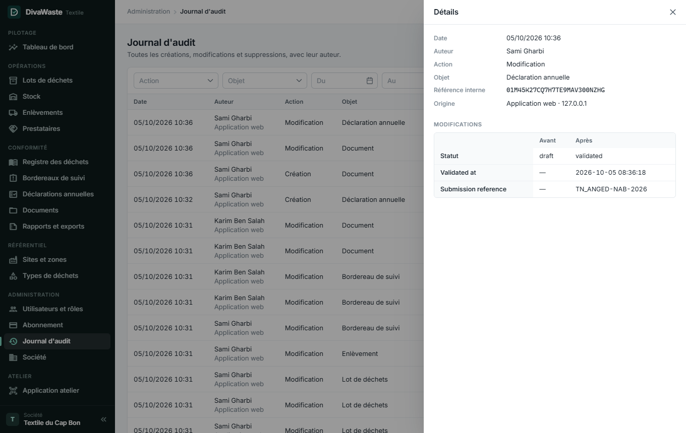

### Mon compte — `/account/profile`, `/account/security`, `/account/notifications`

Everyone. Profile (name, phone, language); security (change password, enable two-factor authentication with an
authenticator app and recovery codes); notifications (history, and per type: in the application and/or by email).

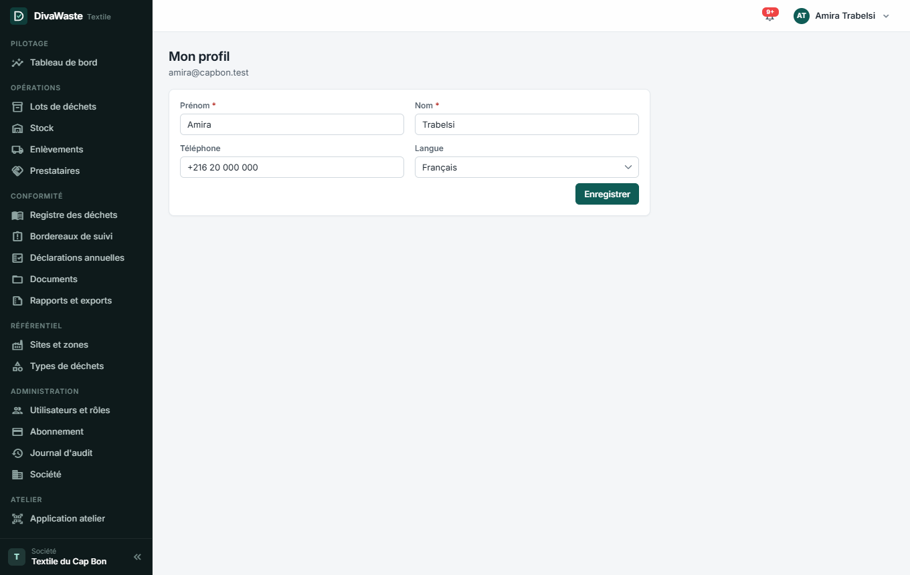
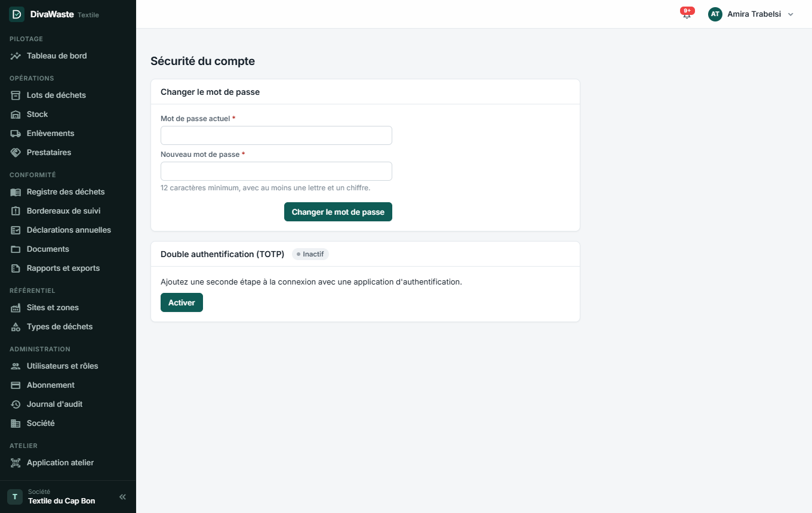

Two-factor authentication: **Activer** shows a QR code and a key for your authenticator application; type the
6-digit code and **Confirmer**. Eight recovery codes are then shown once — keep them. From then on, sign-in asks
for the code after the password.

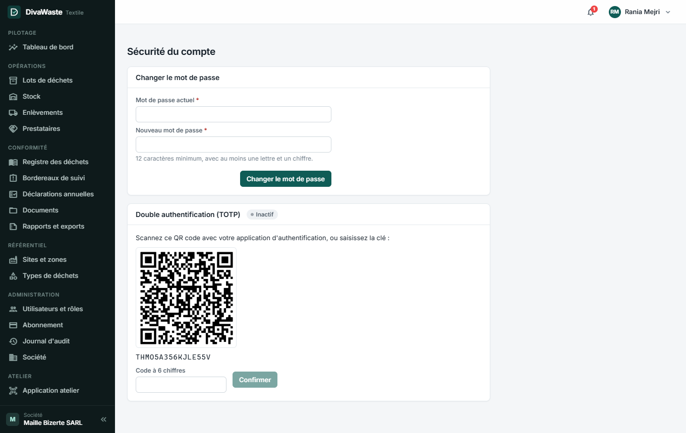
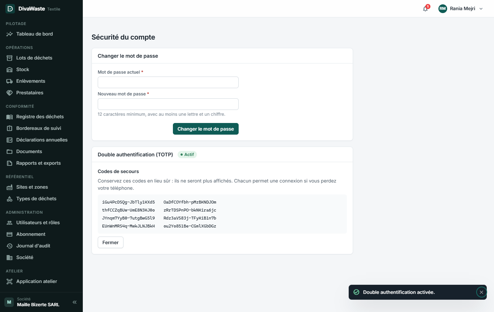
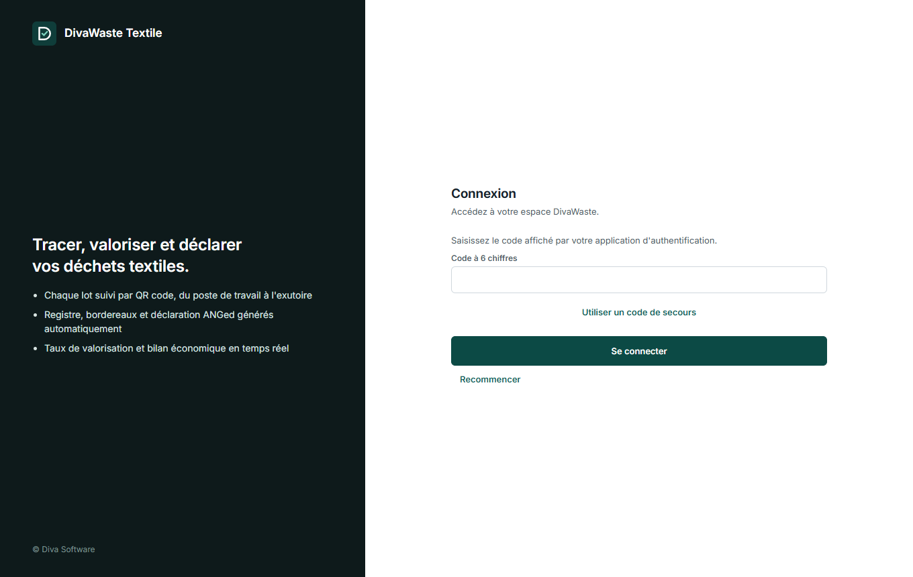
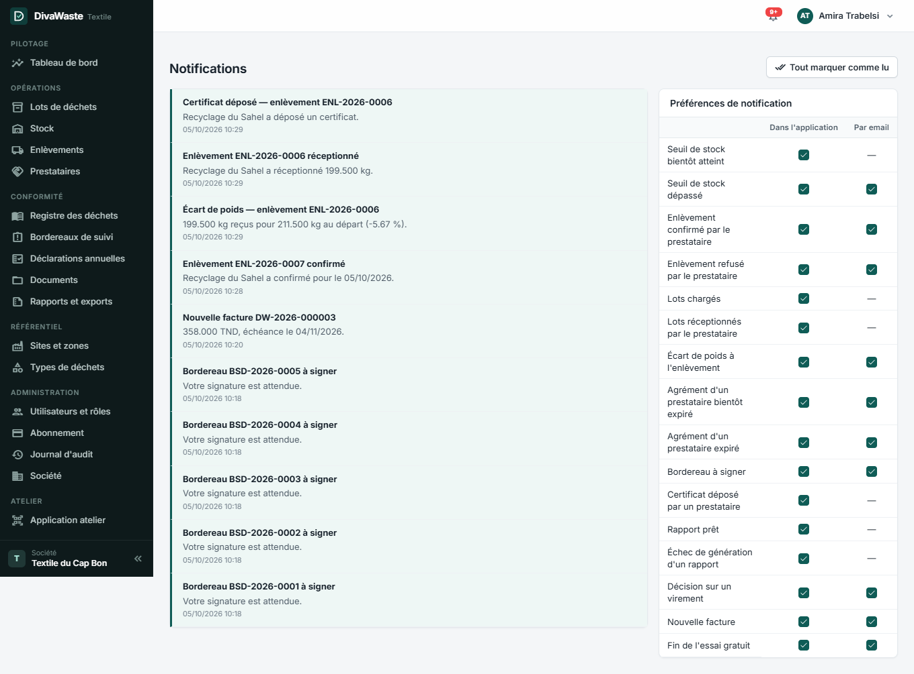

## 5. Environment manager — daily operations

Account: `sami@capbon.test`. Same screens as the administrator except users' management, subscription and
invoices.

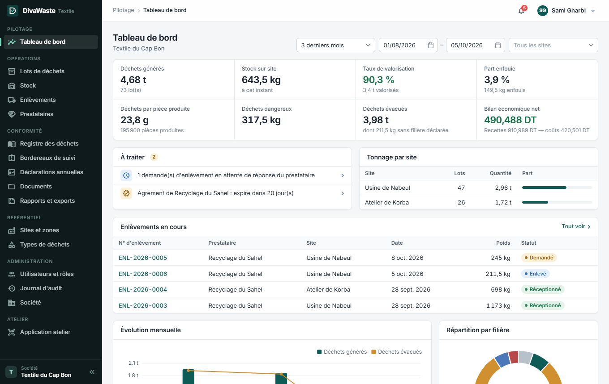

### Lots de déchets — `/lots`

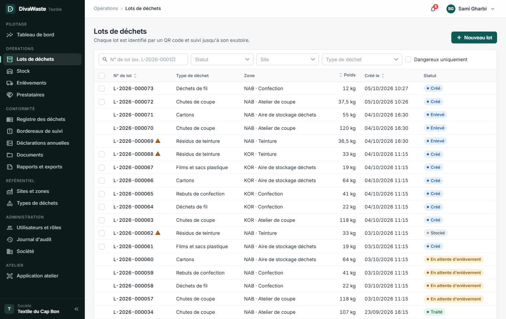

Filters: lot number, status (several), site, waste type, "Dangereux uniquement". Columns: number (⚠ = hazardous),
type, site code · zone, weight, creation date, status. Sort by number, weight or date.

Tick two or more lots of the same site, type and hazard class (status Créé or Stocké) → **Regrouper** merges
them into one lot.

**Nouveau lot**:

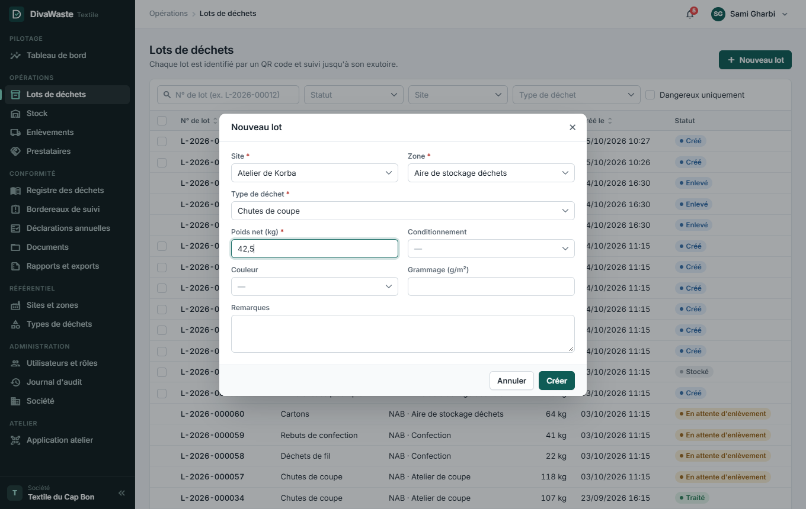

Required: site, zone, waste type, net weight. Optional: packaging, colour, grammage, notes. The lot gets its
number (`L-2026-000072`) and a QR label.

### A lot that is not weighed yet

The weight of a lot may be left empty when it is created: the lot is then **À peser**. It is never recorded as 0 kg.

- It can be stored, moved, labelled (the label prints "non pesé") and put in a pickup.
- It cannot be split or grouped, be priced per kilogram, or pass an authorisation limited in weight: each of these says
  which lot must be weighed and why. A flat price is always possible.
- **Ce poids est une estimation** marks a weight typed without a scale. It is shown with "≈" and "estimé", and is not
  accepted where a measure is required (weight-limited authorisation, price per kilogram on what left).
- Filter **À peser** in the lot list; **Peser** on the lot page; **Peser plus tard** in the workshop application.
- Every total gives the known weight and counts the others beside it: "950 kg + 2 lot(s) non pesé(s)" — on the stock,
  the dashboard, pickups, the register (empty weight cell, counted in the summary line), reports and the tracking slip.
- A stock limit that is not exceeded while lots are unweighed is marked **Non vérifiable**.

### Limits, one by one

A weight, a number of packages and a number of lots are different questions. Each limit is shown on its own line, with
its own figures, unit and result; no percentage of one is ever taken for another.

| Result | Meaning |
|---|---|
| **Respecté** | The limit is met, and every quantity it needs is known |
| **Attention** | Met, but the alert percentage of that limit is reached |
| **Dépassé** | What is known is already above the limit; the excess is given in the unit of the limit |
| **Non vérifiable** | What is known is below the limit, but a quantity is missing: the lots concerned are named. Never read as "Respecté" |

- **Authorisations** (page Autorisations, and the pickup request): one line per limit the document states — **Poids**,
  **Colis (Sac)**, **Colis (Balle)**, **Lots**. Example: "Poids 450 kg / 500 kg — 90 % — Respecté" and "Colis (Sac)
  310 / 300 × Sac — Dépassé de 10 × Sac". The request is blocked as soon as one limit is exceeded or not verifiable,
  and says which ("Demande bloquée — limite(s) en cause : Colis (Sac)"); the other limits stay visible.
  **Each packaging has its own limit**: 300 bags and 40 bales are two limits, and bales never draw on the bags. Only
  when the document itself states one combined quantity ("40 balles ou 100 sacs") tick **« une seule quantité commune »**
  on the authorisation: it is then one limit, "Colis (quantité commune)", shared by its packagings. Authorisations with
  several packagings recorded before this choice existed were counted as shared and stay so: review them one by one.
  A lot that is loose, or in a packaging the document does not name, is covered by its weight or number of lots when
  it states one; in packages only, the document cannot be verified for that lot ("Conditionnements non cités").
- **When the server refuses** (a draft sent later, a number of packages edited on a lot already requested): the message
  says which limit, with its figures — "Refusé par l’autorisation DOUANE-… (type) : limite de 300 × Sac dépassée de
  10 × Sac" or "poids inconnu … pour L-… — l’autorisation est limitée en kg : pesez ce(s) lot(s)".
- **Zones** (Stock, Sites): **Place** (the room of the zone) and **Charge** (kilograms against the weight it bears)
  are two lines. A zone can be at 100 % of its room and 80 % of its load. A loose lot or an unplanned
  packaging makes the room "Non vérifiable"; a lot nobody weighed does the same for the load. A zone alerts; it never
  refuses a lot.
- **Stock limits**: below the limit with unweighed lots is "Non vérifiable"; above it is "Dépassé", and the unweighed
  lots are still listed. A stock limit alerts; it blocks nothing. People who see the stock of the site receive
  **« Limite de stock non vérifiable »** (notification and email) once, when a limit enters that state: it gives the
  site, zone and waste type, the known weight, and the lots to weigh. It is not sent again while nothing changes, and
  it is a different message from "Limite de stock dépassée", which is a known exceedance.

### What a zone and a site can hold

Set on the page of the site (**Sites et zones**). None of these limits ever refuses a lot: they inform and alert.

- **Place d'une zone** — measured **one way per zone**, chosen in the zone form ("Place mesurée en"):
  - **Colis par conditionnement** (as before): "100 sacs ou 50 cartons". Mixed packagings share the same room: 50 bags
    and 25 boxes fill it. A loose lot, or a packaging the zone does not plan, cannot be counted: it is named and the
    room shows "Non vérifiable".
  - **Volume (m³)**: enter the volume of the zone. The room taken is the sum of what each lot takes: packages × the
    volume of one package; for loose waste, the volume it was measured in (litres, m³) or its weight ÷ the density of
    its waste type. A lot whose volume nobody can state is named ("sans volume connu") and never sized by guess. The
    line under the zone lists what takes the room: "100 × Sac (10 m³) · 20 × Carton (5 m³) · 1 lot(s) en vrac (2 m³)".
  The two ways are never added or compared; the figures of the way not chosen stay on record, unused.
- **Volume des conditionnements** (button on the Sites page, for those who manage sites): the room one package takes
  once stored, per packaging, in m³. Empty = not known.
- **Charge d'une zone** — its maximum weight in kg, a separate line. Lots nobody weighed are named.
- **Poids sur le site** — the maximum weight of the whole site (site form: "Poids maximal sur le site" and its alert
  percentage). Every lot on the site counts once, whatever its zone, including zones without any limit. Shown on the
  Sites list, the page of the site and at the top of each site on the Stock page. "Capacité du site non définie" means
  nothing is watched.
- The dashboard lists, under "À traiter", the zones and sites over their capacity and those whose occupancy cannot be
  verified.
- **Notifications.** People who see the stock of the site are told, in the application and by email, when the room of
  a zone, its load or the weight of the site changes for the worse: alert percentage reached ("bientôt pleine /
  atteinte", in the application only), measure incomplete ("non vérifiable": the known figures, and the lots that
  cannot be counted or are not weighed — said not to be an exceedance), or a confirmed exceedance ("dépassée", with the
  excess). Each state is announced once; nothing is sent again while it stays the same, and a state that improves is
  not announced. They can be switched off one by one under Notifications › Préférences. A lot is still never refused.
- **Volumes recorded earlier.** A zone that has a volume (m³) on record while its room is measured in packages shows
  "Volume enregistré, non utilisé : … m³" with **Examiner**; the Sites list says how many zones of each site are in
  this case. Nothing is erased. Whoever manages the zones opens the zone and chooses "Volume (m³)" if that volume is
  its real capacity, or leaves it in packages. The zone form always says which way is in use.
### Packages of a lotA lot is not a package: one lot may be 12 bags. Lot, packages, declared quantity and weight are four separate figures.

- **Nombre de colis** appears on the lot form as soon as the lot has a packaging (chosen, or planned by the waste
  type). Left empty, the lot counts as **1 colis, « par défaut »** until someone confirms or corrects it. A lot without
  packaging is **Vrac**: it has no number of packages, and none is assumed.
- **Zones** fill with packages, whatever the number of lots: a zone of "100 sacs ou 50 cartons" is full with 50 bags
  and 25 boxes. The zone shows what it holds per packaging, the lots still at their default count, and — apart — the
  loose lots and the packagings its capacity does not plan for.
- **Authorisations** stated in packages draw the packages of each lot. One stated in weight only accepts any packaging.
  One stated in packages only cannot be checked for loose waste or a packaging it does not name: the request says which lots.
- On the lot page, **Modifier** changes the count while the lot is on site (a pickup being prepared follows, and its
  authorisation is asked again). Once the lot has left, **Corriger** asks for a reason: the pickup keeps the count it
  left with and shows "corrigé après départ" beside it, slips already issued are not changed, and the authorisation is
  drawn by the corrected count. Every change is in the history of the lot: previous and new count, who, when, why.
- **Fractionner / Regrouper**: the packages of each new lot are asked; they are never copied from the original lots.

**Estimated departure weight.** When a lot left with a weight marked as an estimate (and was not weighed at loading),
the gap at reception is shown as "(indicatif)" and the result is "Référence manquante": an estimate cannot prove that a
tolerance is met, so an explanation is asked before closing.

### A lot — `/lots/:id`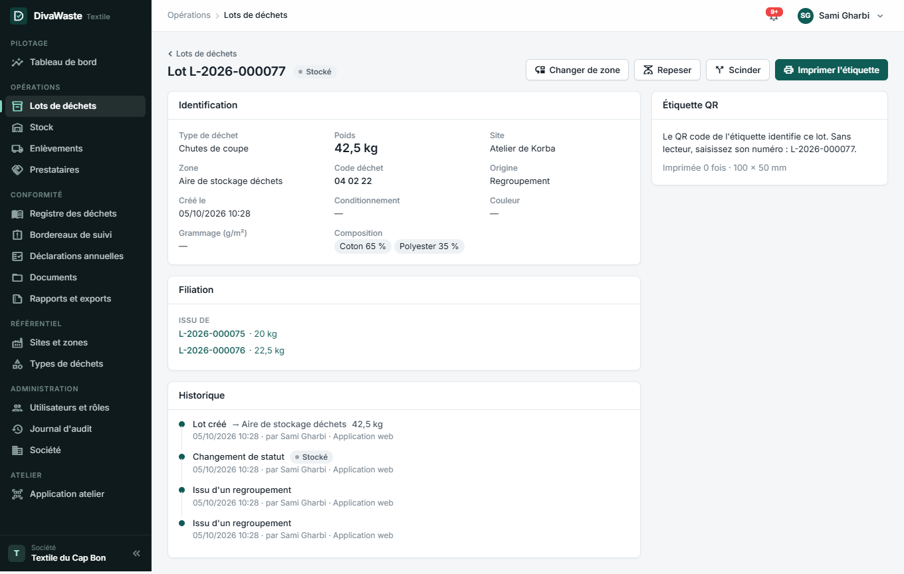

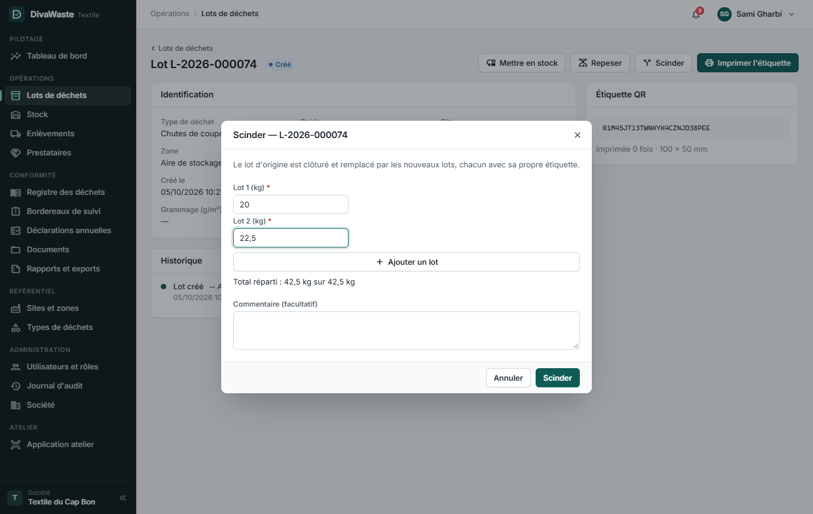
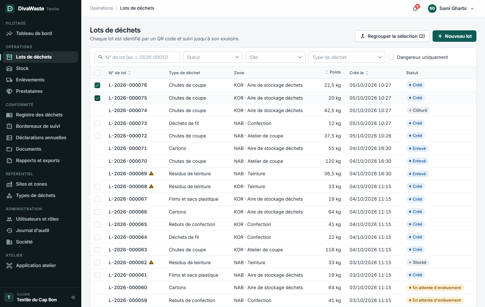
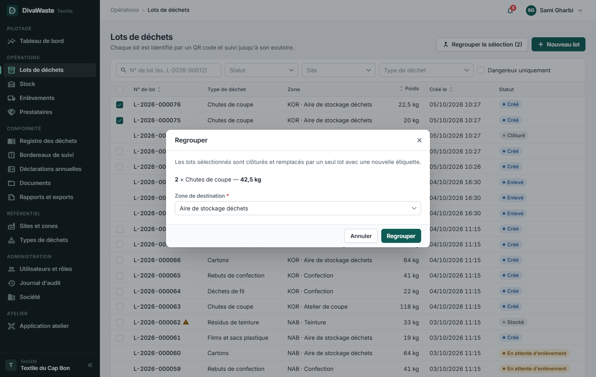

Identification, QR label, full history (who, when, from the web or the workshop app). Actions depend on status:

| Action | When | Effect |
|---|---|---|
| Mettre en stock / Déplacer | Créé, Stocké | Moves the lot to a zone; status Stocké |
| Repeser | Créé, Stocké | Corrects the weight (the old value stays in the history) |
| Fractionner | Créé, Stocké | Splits into several lots; a difference above 2 % needs a comment |
| Imprimer l'étiquette | always | 100 × 50 mm QR label |

### Stock — `/stock`

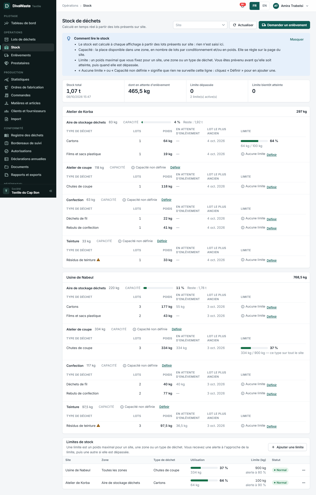

Computed live from the lots on site. Figures: total, part already in a pickup request, limits exceeded or
close (with the number of active limits, or "aucune limite définie"). Then, per site and zone, the weight by waste type, the number of lots, what is waiting for pickup and the
date of the oldest lot. For a zone with a capacity: a bar, the percentage and what still fits ("Reste : 3 × Balle ou
7 × Sac · 880 kg"). "lot(s) non compté(s)" are lots without packaging, or with a packaging the capacity does not
mention: they are not in the percentage. "lot(s) hors affectation" are lots of a type or colour the zone is not meant for.

Each zone says its **capacité** (the bar) or, when none is set, "Capacité non définie" with a link to define it on
the site page. Each line has a **Limite** column: the most precise limit that covers it, with a bar, the
percentage, what it measures ("64 kg / 100 kg") and, when the limit is wider than the line, what it covers ("toute la
zone", "ce type sur tout le site", "tout le site"). A line that nothing watches says "Aucune limite" and offers
**Définir**, which opens the form already set on that zone and that waste type.

**Limites de stock** (called "seuils" before): a maximum for a site, a zone or a waste type, stated in the unit of
the restriction. A notification is sent when the stock reaches the alert percentage of the limit, another when it is
exceeded, another when it can no longer be verified. "Ajouter une limite", or "…" on a line to edit or delete.

- **Unit** ("Limite exprimée en"): kilograms or tonnes; a **number of packages of one packaging** (bags, bales,
  cartons, drums…) — the form then asks which packaging; **pieces**, **litres** or **cubic metres** only when one
  waste type is chosen and that type is counted that way, or says what a piece weighs or how dense it is. The form
  offers only the units that mean something, and writes the limit out in one sentence before saving ("Atelier de
  Korba : alerte quand le stock de « Déchets de fil » dépasse 100 Sac…").
- **Packages are packages**: a lot of 12 bags counts 12, never 1. A limit in bags counts bags only; the other lots of
  the scope (loose, or in another packaging) are not concerned and the line says how many they are. A lot of bags
  whose number of packages is unknown is named, and makes the limit "Non vérifiable".
- **Several limits on the same stock**: a weight and a number of bags are two limits with two answers, each with its
  own bar; neither percentage is compared with the other. Two limits of the same kind on the same scope (two
  weights, even one in kg and one in t) are refused.
- **Unknown is not zero**: a lot that cannot be counted in the unit of the limit (no weight for a weight; no
  quantity and no conversion for pieces or a volume) is named. Below the limit this makes it "Non vérifiable";
  above it the limit is "Dépassé" and the lot is still named.
- The unit of a limit is not edited: to watch the same stock in another unit, add another limit. Limits recorded
  before units existed are in kilograms, unchanged.
- A stock limit alerts. It never refuses a lot.

**Demander un enlèvement** goes to the pickup request.

### Enlèvements — `/pickups`

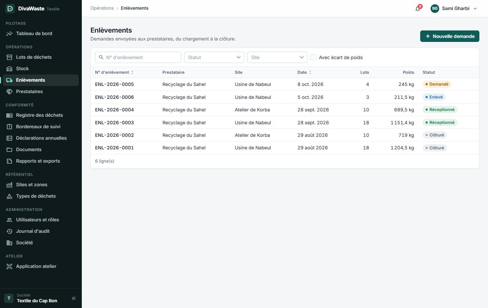

Filters: number, status, site, "Avec écart de poids". Columns: number, provider, site, date, lots, weight,
status.

**Nouvelle demande** — `/pickups/new`:

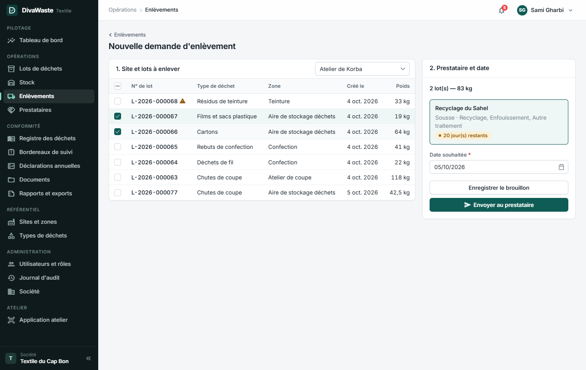

1. Choose the site, tick the lots to send (only lots in stock are listed).

   Once a provider of the platform is chosen, **« Ce que … demande pour cette collecte »** lists what it asks of the
   lots ticked, one line per requirement: the minimum and its unit, what the collection amounts to, what is missing
   ("Au moins 500 kg demandé — la collecte fait 320 kg : il manque 180 kg"), a packaging asked for and the lots that
   are not in it. Each line is "Respecté", "Attention" (a warning: the request can be sent), "Non atteint" (blocking)
   or "Non vérifiable" (a lot concerned has no measured quantity — an estimated weight does not count; the lots are
   named). A blocking line stops "Envoyer la demande"; the draft can still be saved. Someone holding the right to
   send against it (administrator by default) sees a field **Motif de l'envoi malgré l'exigence**: with a reason the
   request goes out, and the pickup shows who sent it and why, to you and to the provider. The same is asked when a
   draft is sent from its page. The requirements and their answers stay on the pickup as they stood that day.2. Choose the **receiver**: a provider of the platform among your partners, or a partner without an account (tag
   "Sans compte"). One that cannot take the selection (hazardous waste without the right authorisation, expired
   authorisation) cannot be chosen, and says why.
3. Choose the **transporter** when it is not the receiver ("Le destinataire assure le transport" by default). A
   receiver that only recycles or eliminates needs one. Give the wished date.
4. **Enregistrer le brouillon** or **Envoyer la demande**.

When the receiver has no account, the pickup page offers you its stages: **Confirmer une date** or **Refuser**,
then, after the loading, **Enregistrer la réception** (weights received) and **Déclarer le traitement** (channel).
A receiver of the platform keeps doing these itself.

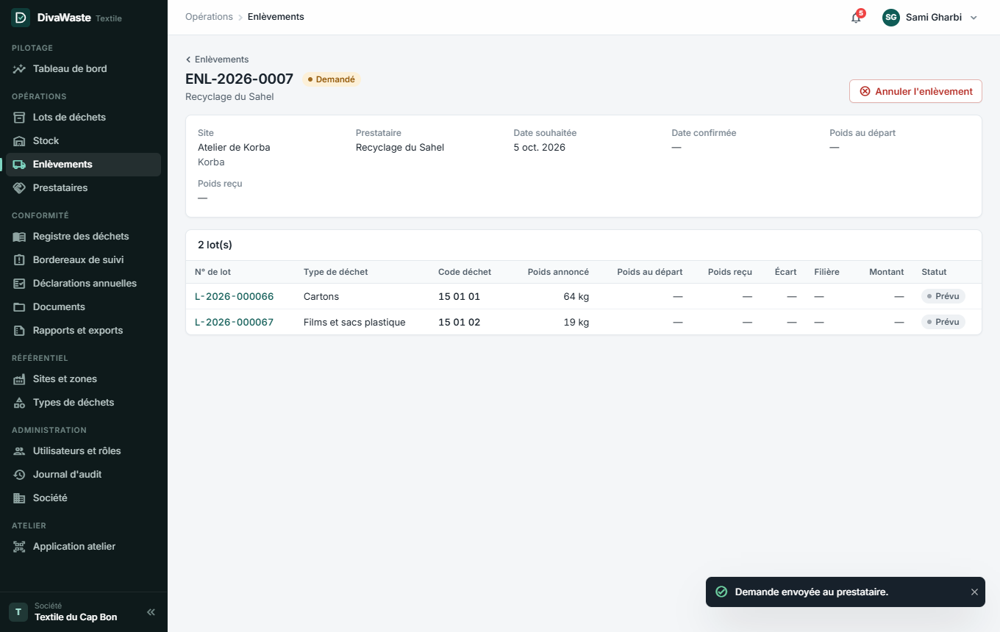

The lots become "En attente d'enlèvement". The pickup then moves through:

| Status          | Who acts              | What happens                                                                              |
| --------------- | --------------------- | ----------------------------------------------------------------------------------------- |
| Brouillon       | Client                | Not sent yet                                                                              |
| Demandé         | Provider              | Confirms a date, or refuses with a reason                                                 |
| Confirmé        | Client's operator     | Loads the lots (scan) on the day → weight at departure                                    |
| Enlevé          | Provider              | Records the weights received                                                              |
| Réceptionné     | Provider, then client | Provider declares the treatment channel and uploads the certificate; client enters prices |
| Clôturé         | Client                | Closes: lots become Clôturé                                                               |
| Refusé / Annulé | —                     | Lots return to stock                                                                      |

**Gaps at reception.** Each lot is compared in its own unit — kilograms for weighed waste, pieces or litres for
counted waste — between what left and what was received:

    gap % = |received − left| ÷ left × 100

with the tolerance that applies to this waste type and this channel (tab Tolérances of the waste types). **Filière
prévue**, on the request, replaces the channel each type plans. The block **Écarts à la réception** of the pickup says
it in words for each lot: Parti, Reçu, Différence (signed), Écart, the tolerance applied and where it comes from, and why.

| Result | Meaning | What to do |
|---|---|---|
| Dans la tolérance | Gap within the limit, or on the side the rule does not watch | Nothing |
| À justifier | Above the warning limit | **Prendre en compte l'écart**, with an explanation (pickups.complete) |
| Accord requis | Above the blocking limit | **Accepter l'écart**, with its reason (pickups.authorize_variance) |
| Référence manquante | Nothing reliable left (0 or unknown): no percentage is computed | Check what left, then explain |

The pickup cannot be closed while a gap waits. What was declared, what left and what was received stay three separate
figures. A lot that left but was not received shows in the total of the weighed lots. Under the list of pickups,
**Écarts à la réception par type de déchet** counts the receptions per type and marks repeated gaps.

Limits: counted lots cannot be split or grouped (those share out a weight); a counted lot is priced as a flat amount
unless it has a weight; waste authorisations remain in kilograms, packages and lots (stock limits may be in pieces
or volume, see Stock).
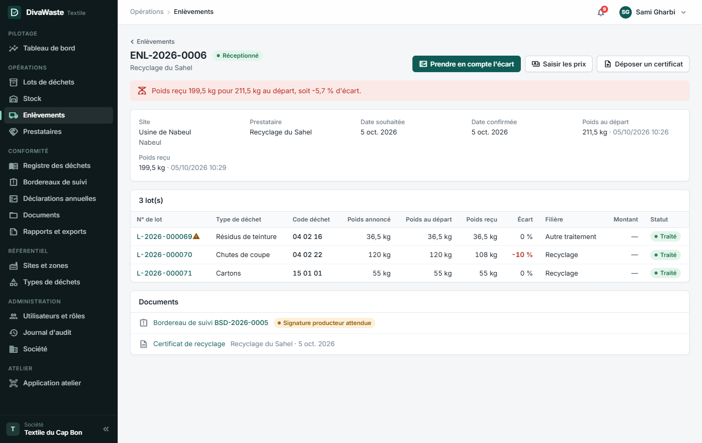
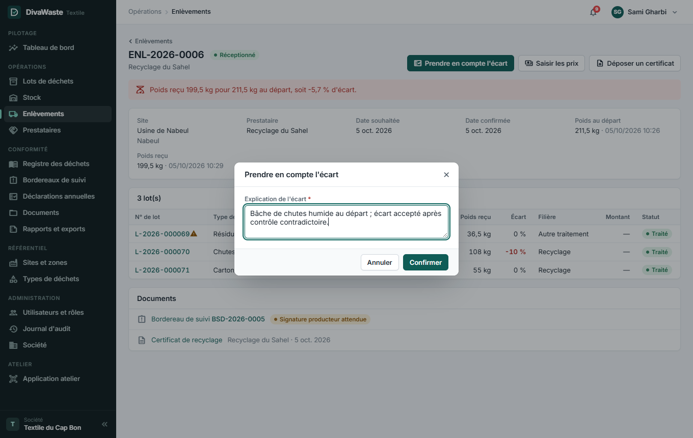
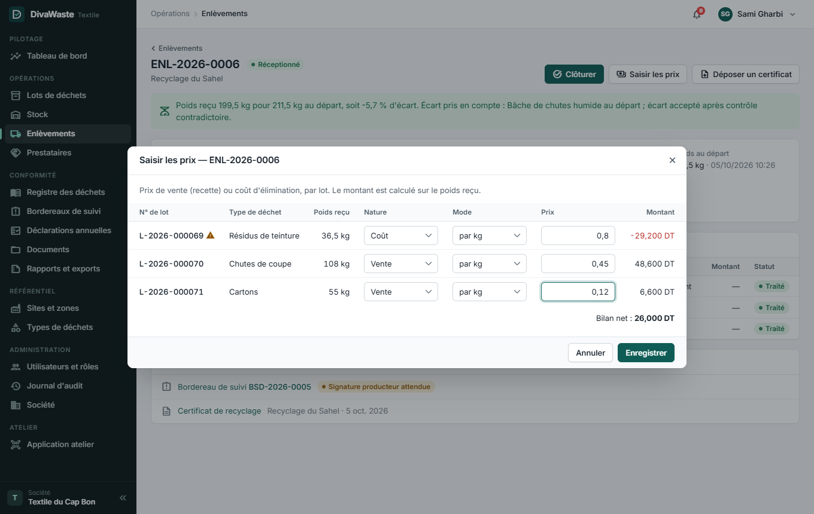
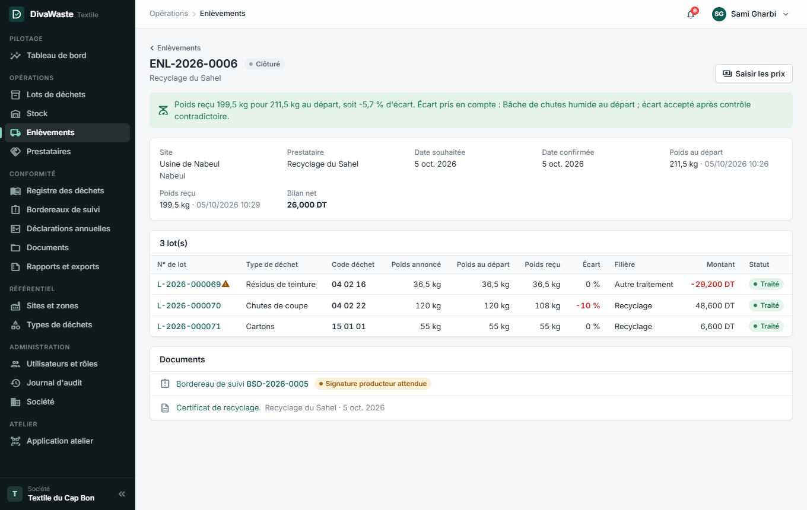
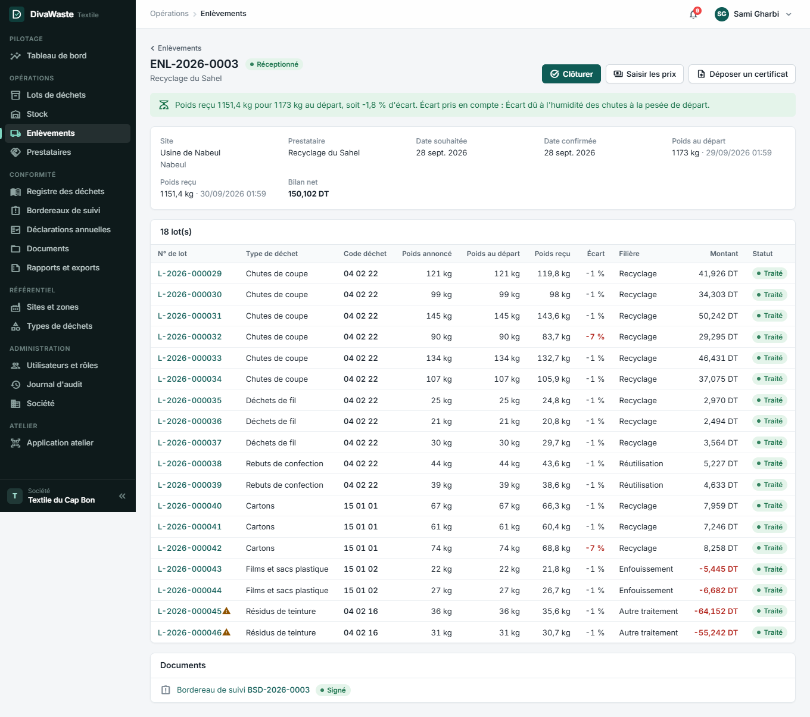

Other actions on a pickup: **Saisir les prix** (per line: sale or cost, per kg / per tonne / flat),
**Déposer un certificat**, **Clôturer**, **Annuler l'enlèvement**.

## Production — clients, materials, orders and manufacturing orders

*View: production.view. Change and import: production.manage. Prices, costs, invoices and gains:
production.finance.view (without it every amount is hidden and cannot be written).*

Optional. It says **where each waste comes from** — manufacturing order (OF), order, client, raw material, received
lot and supplier — and **what an OF cost and is worth**. It is not an ERP: no planning, no purchasing workflow, no
stock. A company that does not use it keeps working exactly as before.

**Three kinds of lot, never to be confused:**

| | Lot reçu | Lot fabriqué | Lot de déchets |
|---|---|---|---|
| What | A delivery of raw material | Finished goods made by an OF | Waste from production |
| Belongs to | A material, **from a supplier** | An OF, **for its client and order** | The waste register |
| Where | Material page, "Lots reçus et fabriqués" | OF page, "Lots reçus et fabriqués" | Opérations → Lots de déchets |

None of the first two is a stock: no balance, no location, no movement. A produced lot has no supplier.

### A raw material — `/production/catalog/:id`

Clicking a material opens its page. Four figures on top: lots received, quantity consumed (and in how many OFs),
quantity consumed **without a lot specified**, and the average purchase price. Tabs:

- **Aperçu**: reference, category, unit, default supplier, composition, colour, grammage, width, waste that came from it.
- **Lots reçus**: each delivery with **its own supplier**, the supplier's lot number, date, quantity, what the OFs
  declared taking from it, its unit cost, its purchase value and the value consumed. **Nouveau lot reçu** proposes the
  supplier of the material; choose another one when this delivery came from someone else. Type the unit price *or* the
  amount: the other is computed from the quantity (two figures that disagree are refused). Delivery costs are spread
  over the quantity of the lot. Changing the default supplier of the material later never changes the lots already
  received. A red figure means the OFs declared more than the lot held.
- **Consommations**: the last 200 consumptions, each with its OF and the lot it came from.
- **Prix d'achat**: the cost of each delivery over time, and the average weighted by quantities.

### A manufacturing order — `/production/manufacturing-orders/:id`

Clicking an OF opens its page: the chain client → order → OF → article, then

- **Étapes**: the stages, each on its site, with the pieces done.
- **Matières consommées**: for each material, planned (consumption per piece × planned quantity), consumed, the gap,
  and one line per **received lot** with its supplier, stage, date, quantity and cost. **Modifier les consommations**
  edits them: 12 kg of lot A and 8 kg of lot B are two lines; if nobody knows which lot was used, leave **Lot non
  précisé** — the application never picks one.
- **Lots fabriqués**: the batches of finished goods, each with its number, date, quantity and status (fabriqué, livré,
  annulé). As soon as an OF has produced lots, its produced quantity is their sum.
- **Lots de déchets**: the ordinary waste lots that name this OF, with a link to each; **Enregistrer un déchet** opens
  the usual lot form with the OF already chosen. The waste rate is given only when every consumption can be expressed in kg.
- **Coûts, chiffre d'affaires et gain** (amounts excluding tax):
  - *Coût matière réel* = quantity consumed × cost of the received lot it came from. A lot used by several OFs is
    charged to each for what it consumed, never in full.
  - *Coût matière estimé* = lots not specified, at the average price of the material. Shown apart, tagged "estimé".
  - A consumption whose material has no priced lot at all is **inconnu** — never zero — and makes the cost incomplete.
  - *Autres dépenses*: subcontracting, services, purchases, transport, labour if you enter it. Add, edit, delete.
  - *Valeur de la production* = pieces made × the price agreed on the order line (discount of the order spread pro rata).
  - *Facturé*: the invoices recorded on the order, less credit notes. They are the OF's when the invoice names it or
    when the order has one OF only; otherwise they stay with the order and nothing is shared out.
  - *Gain enregistré* = value of the production − recorded costs. Given only when price, production and every cost
    are known; otherwise the page says what is missing. It is a gross figure on entered costs, not an accounting result.

### An order — `/production/orders/:id`

The articles with their agreed unit price, an optional discount, the OFs of the order with their cost, value and gain,
and **Factures et avoirs**: number, date and amount of what was issued elsewhere. The page shows three different
amounts: value of the order, invoiced, still to invoice.

### Lots reçus et fabriqués — `/production/lots`

Two lists side by side: every received lot (search, supplier, with or without a price) and every produced lot
(search, client, status). A row opens the material or the OF.

### Coûts et gains — `/production/finance`

*production.finance.view.* For a period: recorded cost, value of the production, invoiced amount and gain, by OF, by
client, by material (planned against consumed, quantity without a lot) and by supplier. A box lists the OFs whose
gain could not be calculated and why; totals only add the gains that exist. **Exporter (Excel)** gives the OF table.
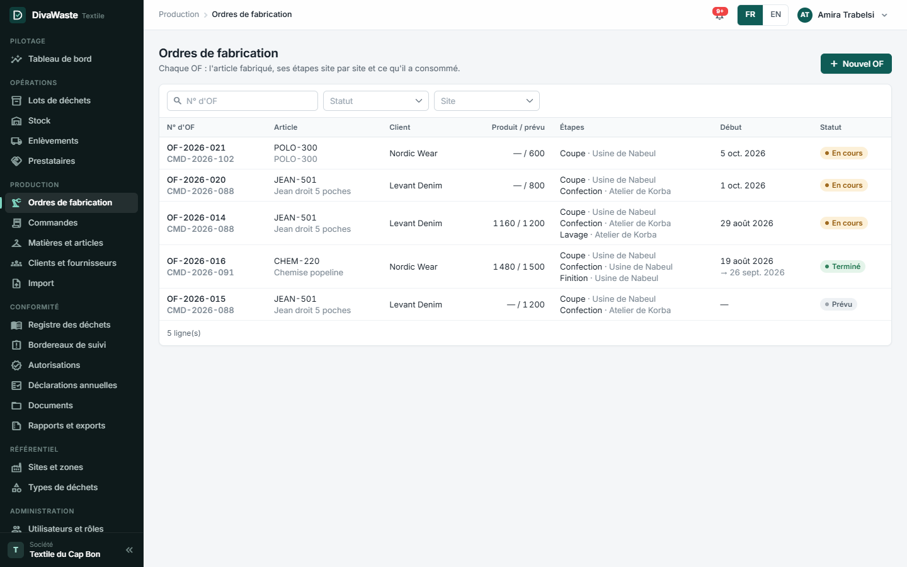

- **Clients et fournisseurs** — `/production/partners`: code, name, country, contact.
- **Matières et articles** — `/production/catalog`:
  - a **matière première** has a reference, a supplier, a unit (metre, kilogram or piece), a colour or Pantone
    reference, a composition (must total 100 %) and its **lots reçus** (deliveries: batch number, date, quantity);
  - an **article** has a reference, a family, a client, and its **consommation par pièce** of each material.
- **Commandes** — `/production/orders`: number, client, dates, status, and the articles ordered with quantities.
- **Ordres de fabrication** — `/production/manufacturing-orders`: number, article (one of the order's when an order is
  chosen), planned and produced quantities, dates, status, then:
  - **Étapes**: the stages the OF goes through, **each on its own site** (cut on one site, sewn on another), with
    the pieces done at each. The stages offered are the platform's (coupe, confection, lavage, teinture, finition,
    contrôle qualité, emballage) plus the ones the company adds;
  - **Matières consommées**: what the OF really consumed, optionally from which received batch. The form shows
    the expected quantity (planned quantity × consumption per piece) next to the real one, in red when it is above.

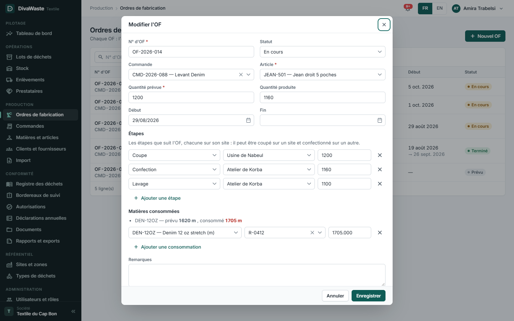

### Where a waste comes from

A lot can say its **manufacturing order**, the **stage** it was produced at, and the **raw material** (and received
batch) it is made of. All of it is optional, and most of it is deduced:

- In **Nouveau lot** (and in the workshop application, one extra screen "Pour quel OF ?" when the site has open
  orders, the last one used first, "Sans OF" always possible), you choose the OF.
- The **stage** is the one the zone stands for (a lot created in a zone of type Coupe comes from cutting), or the
  only stage the OF has on that site. So a lot created without an OF still knows its stage.
- The **material** is the one the OF works with when it works with a single one; otherwise it can be chosen.
- The lot then takes the **composition and colour of its material** (before the defaults of the waste type).

The lot page shows the whole chain under **Origine en production**: OF, stage, article, client, order, material,
batch, supplier. A split keeps the origin; a grouping keeps it only where all its lots agree. The origin of a lot
can be given or corrected afterwards with **Origine** on the lot page (permission `lots.update`).

In the workshop application, **Scanner la fiche de l'OF** reads the bar code or QR code printed on the OF sheet
(it must contain the OF number) instead of picking the OF in the list.

### Statistiques — `/production/stats`

*production.stats.view.*

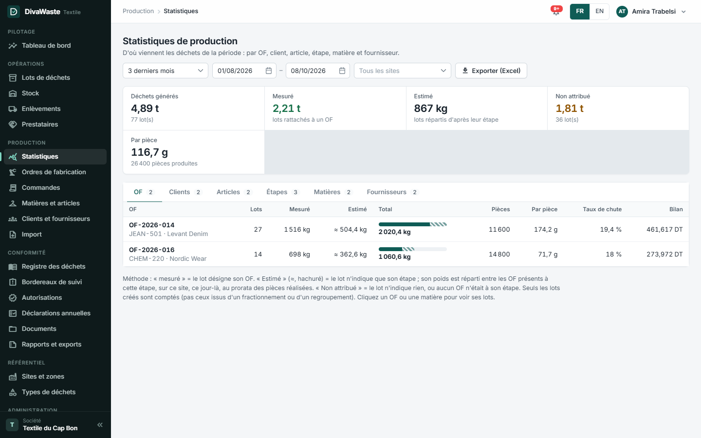

For a period (and a site): the waste generated, then six tables — by OF, client, article, stage, raw material and
supplier — with lots, weight, pieces, grams per piece, waste rate and money balance, then the evolution month by
month. **PDF** and **Exporter (Excel)** give the same figures. The dashboard shows the five orders that produced
the most waste, with a link to this page. Click an OF or a material to list its lots.

Two kinds of figures are always shown apart:

- **Mesuré**: the lot names its OF.
- **Estimé** (≈, hatched bar): the lot only says its stage. Its weight is shared between the OFs that were at
  that stage, on that site, that day, in proportion to the pieces they made there.
- **Non attribué**: the lot says nothing, or no OF was at its stage. It is never guessed further.

**Taux de chute** is the share of the consumed material that became waste. It needs the consumption of the OF in
kilograms: either the material is counted in kg, or it is counted in metres and its **laize (cm)** and **grammage**
are filled in. Otherwise the column shows "—".

**Pieces produced** per site and month (used by the dashboard's "déchets par pièce produite") are counted from the
finished OFs: the produced quantity, in the month the OF finished, on the site of its last stage. A month typed by
hand is never overwritten.

### Import — `/production/import`

Eleven kinds of file, best imported in this order: matières premières, **lots reçus** (supplier, quantity, price),
articles, commandes (with unit price), OF, **matières consommées** (OF, material, quantity, received lot or empty),
**lots fabriqués**, **dépenses**, **factures**, clients, fournisseurs. Each column shows an example of what is
expected. Lots, consumptions, produced lots, expenses and invoices require their parent (material, OF, order) to
exist: an unknown one is an error on its line, with the line number — nothing is created or chosen in its place.
Importing the same file twice changes nothing. Amounts are imported only by who may see them.
Any Excel or CSV file can be imported; its columns need no particular names or order.


1. Choose what the file contains (manufacturing orders, orders, articles, raw materials, clients, suppliers) and
   the file. Its first line must be the headings. **Télécharger un modèle vide** gives a file with the expected
   headings for who has no export to start from.
2. For each piece of information, check the column the application proposes (guessed from the headings, with an
   example value next to it) and correct it. Information marked * must have a column.
3. **Vérifier sans importer** reads every line and writes nothing: it says how many lines would be created or
   updated, and lists each line in error with its line number in the file and the reason.
4. **Importer** writes the valid lines. Lines in error are skipped; fix them in the file and import it again —
   what is already imported is recognised (by code, reference or number) and not duplicated.

What a line points to is created when it does not exist: importing manufacturing orders creates the client, the
order and the article they name, so one flat export of an ERP is enough. Several lines of the same OF add its
stages (one per line, with its site) and its consumptions. Dates are read as `JJ/MM/AAAA` or `AAAA-MM-JJ`, numbers
with a comma or a point; semicolon-separated CSV files are accepted.

## 6. Compliance
### Registre des déchets — `/compliance/register`

*Permission: documents.view.* The chronological register required by regulation, built automatically from the
lots: nothing is typed.


Filters: period, site, "Dangereux uniquement". Columns: date, lot, site and zone, type, regulatory code, weight,
status, exit (pickup and date), provider, channel. **Exporter en PDF / Excel** prepares the file; it appears in
Rapports when ready.

### Bordereaux de suivi — `/compliance/manifests`

Every waste leaves with a tracking slip, **hazardous or not**: one slip per waste code of a pickup, issued
automatically when the lots are loaded (or earlier with **Établir les bordereaux de suivi** on a confirmed pickup),
pre-filled, and signed in order by the producer, the transporter and the receiver.

Each party signs one of two ways:

- **Électronique**: the user's password. Who, when, from where and the fingerprint of the content are kept.
- **À la main**: print the slip (**Ouvrir le PDF** — it has a "Signature et cachet" box for every party that has not
  signed electronically), have it signed, then **Enregistrer la signature**: name of the signatory, date, and your
  password. A partner without an account can only sign this way; you record its signature.

A slip signed electronically by everyone is archived at the last signature. As soon as one signature is handwritten,
the slip waits for **Joindre l'exemplaire signé**: the scan (PDF, JPG or PNG) closes it and becomes the archived
document.


Columns: slip number and pickup, waste, packages, weight, the three signatures (producer, transporter, receiver)
with who signed and when, status. **Signer** asks for your password (this is the electronic signature);
**Ouvrir le PDF** shows the document.


### Autorisations — `/compliance/authorizations`

*View: waste_types.view. Change: waste_types.manage.*


Some waste only leaves the site under an authorisation (a declaration signed by customs). Tick **"Ce déchet ne sort
du site que sous autorisation"** on the waste types concerned (Types de déchets), then record each authorisation
here with **Nouvelle autorisation**: waste type, reference, period, and the **allowed quantity written as the
document states it** — a maximum weight, a maximum number of lots, and/or a number of lots per packaging
("60 balles"). Mixed packagings add up as for a storage zone, and when several limits are given the most used one
counts. The signed document can be attached.

Each line shows how much is used and what is left. Usage is counted from the pickups: a pickup holds its share
as soon as it is **requested**, and gives it back if it is cancelled or refused.

A pickup containing such waste is **refused** when no authorisation covers it on the pickup date, or when the one
that does has not enough room left — the request form says so before sending, and shows what the pickup will leave
("utilisée à 20 % après cet enlèvement"). Record a new authorisation to continue. You are told when one reaches its
alert level (80 % by default) and 30 and 7 days before it ends.

Once pickups draw on an authorisation, its waste type, period and quantities are frozen; the reference, the notes,
the alert level and its withdrawal ("En vigueur" unticked) can still change. Nothing is deleted.

### Déclarations annuelles — `/compliance/declarations`

*Prepare: declarations.prepare. Validate: declarations.validate.*


Choose a site and a year, **Préparer une déclaration**: produced, hazardous, evacuated and year-end stock are
computed from lots and pickups, with the detail by waste code and by channel. **Recalculer** after corrections,
**Valider la déclaration** to freeze it, **Exporter** in PDF or Excel. The layout is an approximation of the
ANGed form, not the official form.

### Documents — `/compliance/documents`

Archive of slips, certificates, declarations and reports, filter by type and year, download.


## 7. Reports

### Rapports et exports — `/reports`

*View: reports.view. Export: reports.export. Production volumes: production_volumes.manage.*


**Générer un rapport**: choose the report (CSR waste report, register, …), the format (PDF or Excel), the period
and the site, then **Générer**. The line shows "En préparation" then "Prêt" with **Télécharger**; files are kept
30 days.

**Pièces produites**: number of pieces produced per site and month, needed for "Déchets par pièce produite".

## 8. Workshop operator — the `/m` application

Account: `leila@capbon.test` (site *Usine de Nabeul* only). Operators are sent to `/m` at sign-in and never see
the desktop screens. Made for a phone or tablet, with gloves: one decision per screen, large buttons.
Installable on the device and usable without network in the production build.

The black band on top always shows the connection and what is waiting to be sent.

| | |
|---|---|
|  | **Accueil.** *Nouveau lot*, *Scanner*, *Charger un enlèvement*, then "Mes derniers lots" with their state (Synchronisé / À synchroniser). |

### Create a lot — three taps and a weight

For a waste type counted in pieces or litres, the keypad asks for the quantity in that unit instead of the weight.

| 1. Zone | 2. Waste type | 3. Weight | 4. Done |
|---|---|---|---|
|  |  |  |  |

The lot number is shown; **Imprimer l'étiquette** prints the QR label, **Créer un autre lot** starts again with
the same zone.

### Scan a lot

| Camera | Typed code | Lot found |
|---|---|---|
|  |  |  |

Point the camera at the QR code, or tap **Saisir le code à la main** and type the lot number printed on the
label. Then **Mettre en stock** (the lot becomes "Stocké") or **Imprimer l'étiquette**.


### Load a pickup

| Pickups of the day | Scanning | 
|---|---|
|  |  |

Open the confirmed pickup, scan (or type) each lot as it goes on the truck: it turns green. A lot that is not
scanned stays in stock. **Valider le chargement** records the departure; the pickup becomes "Enlevé".

### Without network

| Saved on the device | Home, offline | Queue | After reconnection |
|---|---|---|---|
|  |  |  |  |

The band turns amber ("Hors ligne"). Lots are saved on the device and sent automatically when the network is
back; the lot then gets its number and its label can be printed. Tap the band to open the queue;
**Synchroniser** forces a new attempt. An operation the server refuses stays in the queue, marked in red, with
the reason.

### Signing out


The round button at the top right of every workshop screen, and the tile with your name at the bottom of the home
screen, open **Mon compte**: who is signed in, for which company, and **Se déconnecter**. If lots are still waiting
on the device, a message says how many: they stay on the device under your name and are sent as soon as the network
is back, even after you signed out. The next person signs in with their own account on the same tablet.
## 9. Direction — read-only

Account: `direction@capbon.test`. Sees the dashboard, lots, stock, pickups, providers, documents, reports,
subscription and audit — with **no action button**.


Can generate and download reports (reports.export) but cannot enter production volumes.

## 10. Auditor / donor — read-only trail

Account: `audit@capbon.test`. Lands on the lots. Sees lots, pickups, the register, slips, documents and reports;
no dashboard, no stock, no administration. Any other address sends back to the lots.


## 11. Provider workspace

Account: `karim@sahel-recyclage.test` (*Recyclage du Sahel*). Access is free for providers.

### Demandes d'enlèvement — `/provider/pickups`


Requests addressed to you: number, client, site and city, date, lots, weight, status. Open one:


| Action | When | Effect |
|---|---|---|
| Confirmer une date | Demandé | Proposes the pickup date; the client is notified |
| Refuser | Demandé | With a reason; the lots return to the client's stock |
| Enregistrer la réception | Enlevé | Weight received per lot |
| Déclarer le traitement | Réceptionné | Treatment channel per lot |
| Déposer un certificat | from Enlevé | Recycling or destruction certificate (PDF) |


### Bordereaux de suivi — `/provider/manifests`, Documents — `/provider/documents`

Slips to sign as transporter and as receiver (same password signature as the client), and the archive of your
certificates.


### Profil et déchets acceptés — `/provider/profile`

What clients read in the directory: activities, description, area, contact, and the waste families you accept
with their channel.

For each accepted waste you may say what you ask of a **collection** (the whole pickup, never lot by lot):

- **Minimum par enlèvement**, with its unit ("Exprimé en"): kilograms, tonnes, pieces, litres, cubic metres, or a
  number of packages — then "Conditionnement compté" says which packaging is counted (20 bales are not 20 bags).
- **Conditionnement demandé**: the packaging you want this waste to arrive in, when you ask for one.
- **Refuser la demande si ce n'est pas respecté**: unticked (the default), the client is warned and may send its
  request, which you receive with the warning. Ticked, a collection that falls short — or whose quantity cannot be
  verified because a lot was not measured — cannot be requested from you, unless someone entitled at the client
  sends it all the same with a written reason; you read that reason on the request and accept or refuse as usual.

Several lines may concern the same waste (a weight and a number of bales): each is judged on its own. Minimums
entered before units existed are in kilograms and warn. Changing a line never changes a pickup already requested:
each pickup keeps the requirement it was judged against.


### Agréments — `/provider/accreditations`

Your accreditations with their validity. **Ajouter un agrément** (type, reference, authority, dates, PDF): it is
checked by Diva Software before it counts. Without a valid, approved accreditation you cannot be chosen.


### Utilisateurs — `/admin/users`

Same screen as for a client: invite colleagues as provider administrator or provider operator.

## 12. Platform administration

The back office of Diva Software is described screen by screen in
[PLATFORM_ADMIN_GUIDE.md](PLATFORM_ADMIN_GUIDE.md).


## 13. Status reference

| Object | Status | Meaning |
|---|---|---|
| Lot | Créé | Just created, not stored yet |
| | Stocké | In a zone, available for a pickup |
| | En attente d'enlèvement | Included in a pickup request |
| | Enlevé | Loaded on the provider's truck |
| | Traité | Treatment declared by the provider |
| | Clôturé | Pickup closed; end of the trail |
| Pickup | Brouillon, Demandé, Confirmé, Enlevé, Réceptionné, Clôturé, Refusé, Annulé | See [Enlèvements](#enlèvements--pickups) |
| Pickup line | Prévu, Chargé, Non chargé, Reçu, Rejeté, Traité | State of one lot within the pickup |
| Tracking slip | Signature producteur / transporteur / destinataire attendue, Exemplaire signé à joindre, Signé, Annulé | Whose signature is missing, or that the scan of the hand-signed slip is still to attach |
| Declaration | Projet, Validée | Draft (recomputable) or frozen |
| Accreditation | À valider, Approuvé, Rejeté; Valide, Expire bientôt, Expiré | Review by the platform; validity in time |
| Company | Email à confirmer, En attente de validation, Active, Rejetée, Suspendue | See the platform guide |
| Subscription | Essai gratuit, Actif, Paiement en retard, Résilié, Terminé | |
| Invoice | À régler, Partiellement réglée, Réglée, En retard, Annulée | |
| Member | Actif, Suspendu | |
| Invitation | En attente, Acceptée, Expirée, Révoquée | |
| Threshold | Normal, Seuil proche, Seuil dépassé | Below 80 %, 80–100 %, above |
| Workshop operation | À synchroniser, Synchronisé, Échec | Offline queue |

## 14. Data isolation between companies

A company never sees another company's data. Signed in as the second client (`nour@monastir-jeans.test`), the
address of a lot of Textile du Cap Bon answers:


