# Platform administrator guide

You are the person running DivaWaste as a SaaS platform: you work for Diva Software, not for a textile company.
This guide shows every screen of the back office and what to do on each, with screenshots taken from the running
application (re-captured on 5 October 2026). Screen labels are quoted in French, as they appear.

- **URL**: http://localhost:4300 (demo environment, see [DEVELOPER_RUNBOOK.md](DEVELOPER_RUNBOOK.md))
- **Account**: `admin@divawaste.test` / `DivaWaste!2026` — role *Super-administrateur plateforme*
- **First screen after sign-in**: `/platform/overview` — "Vue d'ensemble"

## Contents

1. [What the back office is](#1-what-the-back-office-is)
2. [Vue d'ensemble — your daily starting point](#2-vue-densemble--your-daily-starting-point)
3. [Sociétés — find, inspect, decide](#3-sociétés--find-inspect-decide)
4. [Scenario A — a company registers and you approve it](#4-scenario-a--a-company-registers-and-you-approve-it)
5. [Rejecting a registration](#5-rejecting-a-registration)
6. [Suspending and reactivating a company](#6-suspending-and-reactivating-a-company)
7. [Can I create a company myself?](#7-can-i-create-a-company-myself)
8. [Formules, prices, invoices and payments](#8-formules-prices-invoices-and-payments)
9. [Providers and accreditations](#9-providers-and-accreditations)
10. [Reference waste catalogue](#10-reference-waste-catalogue)
11. [Rôles et permissions](#11-rôles-et-permissions)
12. [Activité de la plateforme](#12-activité-de-la-plateforme)
13. [Notifications and emails](#13-notifications-and-emails)
14. [What you can and cannot access](#14-what-you-can-and-cannot-access)
15. [Daily and monthly routine](#15-daily-and-monthly-routine)
16. [Known gaps](#16-known-gaps)

---

## 1. What the back office is

The back office is a separate space: dark blue navigation, the word **Back-office** next to the logo, the tag
**Administration de la plateforme** in the top bar and "Opérateur de la plateforme — Diva Software" at the bottom.
A client never sees it; you never see a client's workspace.

| Menu group | Screen | Route | What it is for |
|---|---|---|---|
| Back-office | Vue d'ensemble | `/platform/overview` | What is waiting for you, and the size of the customer base |
| Clients et prestataires | Sociétés | `/platform/companies` | Every registered company: approve, reject, suspend, activate a plan |
| | Agréments à valider | `/platform/accreditations` | Accreditation documents uploaded by providers |
| Abonnements et facturation | Formules et tarifs | `/platform/plans` | The plans offered and their reference price |
| | Factures | `/platform/invoices` | Invoices of every client and what is still due |
| | Virements déclarés | `/platform/payments` | Bank transfers declared by clients, to match with the bank statement |
| Référentiels | Catalogue de déchets | `/platform/catalog` | The reference waste types every client starts from |
| | Rôles et permissions | `/platform/roles` | What each standard role may do, for all companies |
| Suivi | Activité de la plateforme | `/platform/activity` | Who decided what on the platform |

## 2. Vue d'ensemble — your daily starting point

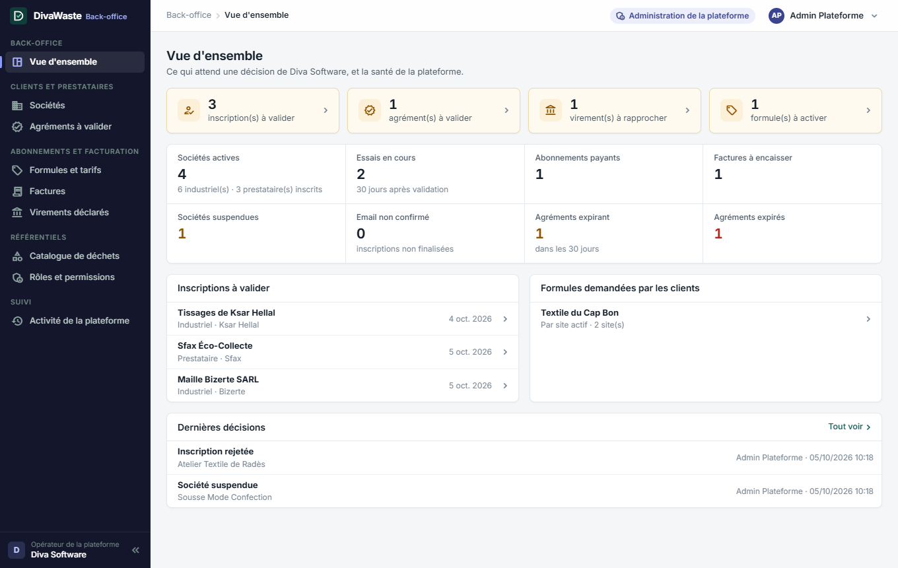

When everything is processed the tiles go back to zero and grey:

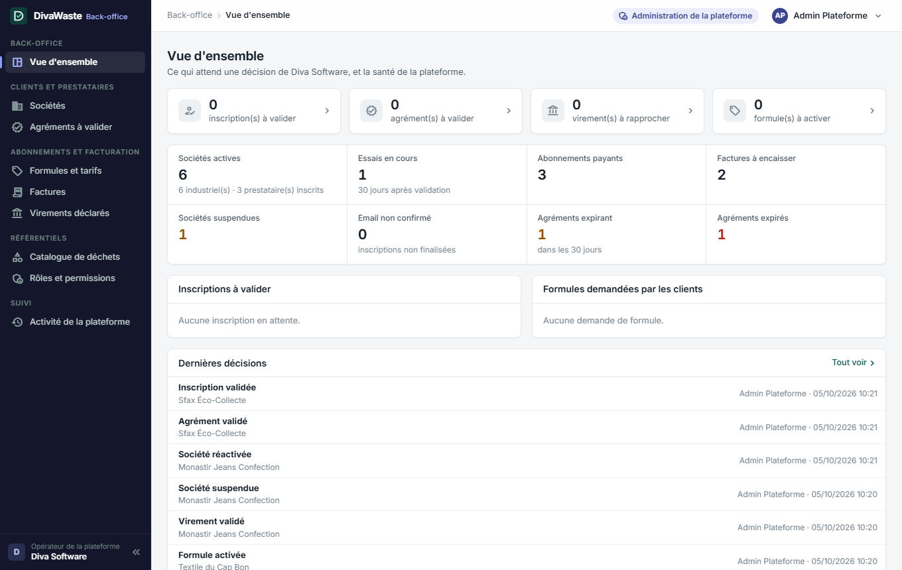

**Top row — what needs a decision.** Each tile is a link; it turns amber when the number is not zero.

| Tile | Meaning | Opens |
|---|---|---|
| inscription(s) à valider | Companies that confirmed their email and wait for your approval | Sociétés, filtered on "En attente de validation" |
| agrément(s) à valider | Accreditation PDFs uploaded by providers, not reviewed yet | Agréments à valider |
| virement(s) à rapprocher | Bank transfers declared by clients, not validated yet | Virements déclarés |
| formule(s) à activer | Active clients that asked for a paid plan | Sociétés |

**Figures.**

| Figure | Meaning |
|---|---|
| Sociétés actives | Companies whose account is active (the hint gives all registered industrials and providers) |
| Essais en cours | Clients in their 30-day free trial |
| Abonnements payants | Clients with an activated paid plan; amber when some are late on payment |
| Factures à encaisser | Issued invoices not fully paid; red when some are past their due date |
| Sociétés suspendues | Accounts you suspended |
| Email non confirmé | Registrations whose contact never clicked the confirmation link (nothing to do yet) |
| Agréments expirant / expirés | Approved accreditations ending within 30 days / already ended |

**Lists.** "Inscriptions à valider" and "Formules demandées par les clients" open the company. "Dernières décisions"
shows the last platform decisions and links to the full activity.

## 3. Sociétés — find, inspect, decide

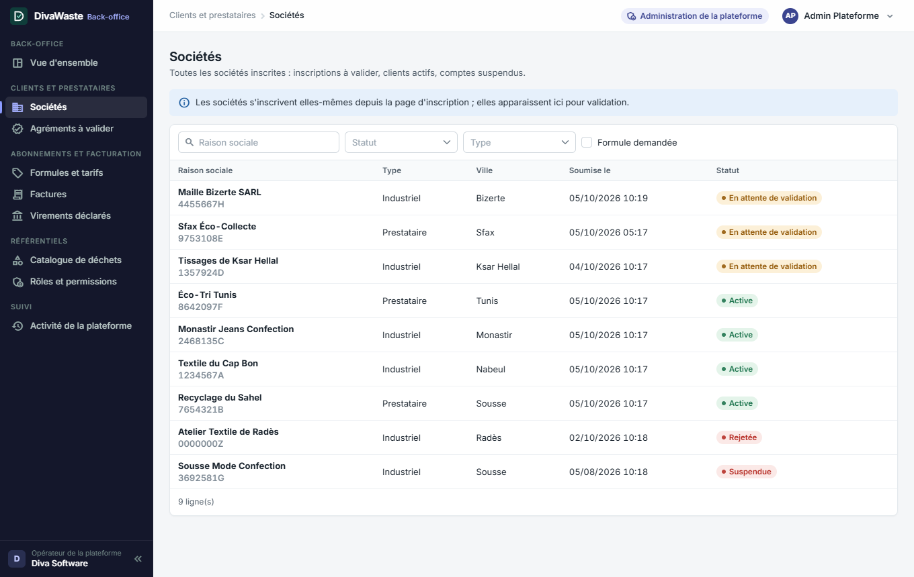

- **Search** by company name or tax identifier ("Raison sociale").
- **Statut** filter: En attente de validation, Email à confirmer, Active, Suspendue, Rejetée, Fermée.
- **Type** filter: Industriel, Prestataire.
- Pending registrations are always listed first. Click a row to open the company.

| Status | Meaning | What you can do |
|---|---|---|
| Email à confirmer | Registered, confirmation link not clicked | Nothing: wait |
| En attente de validation | Email confirmed, waiting for you | **Valider l'inscription** or **Rejeter** |
| Active | Approved | **Suspendre**; for an industrial, **Activer une formule** |
| Suspendue | Access blocked by you | **Réactiver** |
| Rejetée | Registration refused | Nothing: the applicant must register again |

**The company page is where you run a customer account.** Without leaving it you see:

| Panel | Content |
|---|---|
| Header | Name, type, status, and the decision buttons allowed in that status |
| Informations | Tax identifier, address and country, phone, submission date, contact with "Email confirmé", activities, plan asked, usage counters, rejection or suspension reason |
| Agréments (provider) | Each accreditation with reference, validity, review status and its PDF |
| Sites | Code, name, city, open or closed |
| Utilisateurs | Name, email, roles, last sign-in, status |
| Factures | The last 12 invoices with total, paid and status |
| Historique du compte | Decisions taken on this account, with author, date and reason |
| Abonnement (right) | Current plan, price, sites, trial or period end |
| Activer une formule (right) | The activation form, pre-filled with the request and the reference price |

It never shows the client's lots, pickups or documents.

The company page shows the tax identifier, address, contact (with "Email confirmé : Oui/Non"), declared activities,
the plan asked at registration, usage (sites, users, lots) and, for a provider, its accreditations.

## 4. Scenario A — a company registers and you approve it

This is the real sequence, executed while writing this guide with a new company, *Maille Bizerte SARL*.

### Step 1 — the company registers (public page `/register`)

The applicant chooses **Industriel textile** or **Prestataire**, then fills the form.

| Block | Field | Required | Notes |
|---|---|---|---|
| Type de compte | Industriel textile / Prestataire | yes | Decides the workspace the company will get |
| Société | Raison sociale | yes | |
| | Pays | yes | Only countries open for sign-up (Tunisia today). Sets currency, VAT and tax-ID format |
| | Matricule fiscal | yes | Checked against the country's format; must be unique |
| | Ville, Téléphone | no | |
| | Activités textiles | yes (industrial) | |
| Contact principal | Prénom, Nom, Email, Téléphone, Mot de passe | yes | Becomes the client administrator. Password: 12 characters minimum |
| Formule | Essai gratuit / Par site / Par volume | yes (industrial) | Every plan starts with the 30-day trial; this is only what the client intends to take |
| Activité (provider) | Collecteur / Transporteur / Recycleur / Éliminateur, zone, **agréments en PDF** | yes | At least one accreditation with its dates and file |
| Conditions | Acceptance of the legal documents | yes | Recorded with date and version |

After "Créer mon compte":

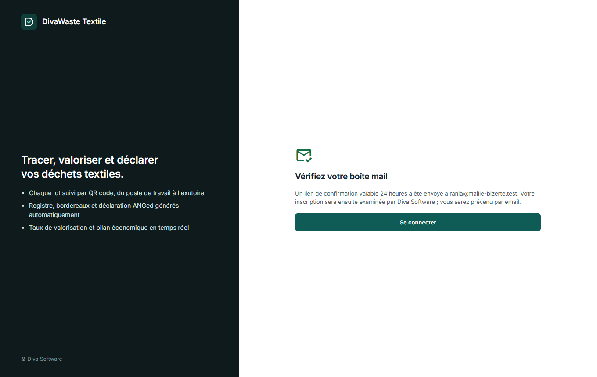

### Step 2 — the applicant confirms the email

The email contains a link valid 24 hours. In the demo environment emails are written to a log:
`powershell -ExecutionPolicy Bypass -File .\scripts\demo.ps1 mail` prints the link.

If the applicant signs in at this point, the only screen available is the account status:

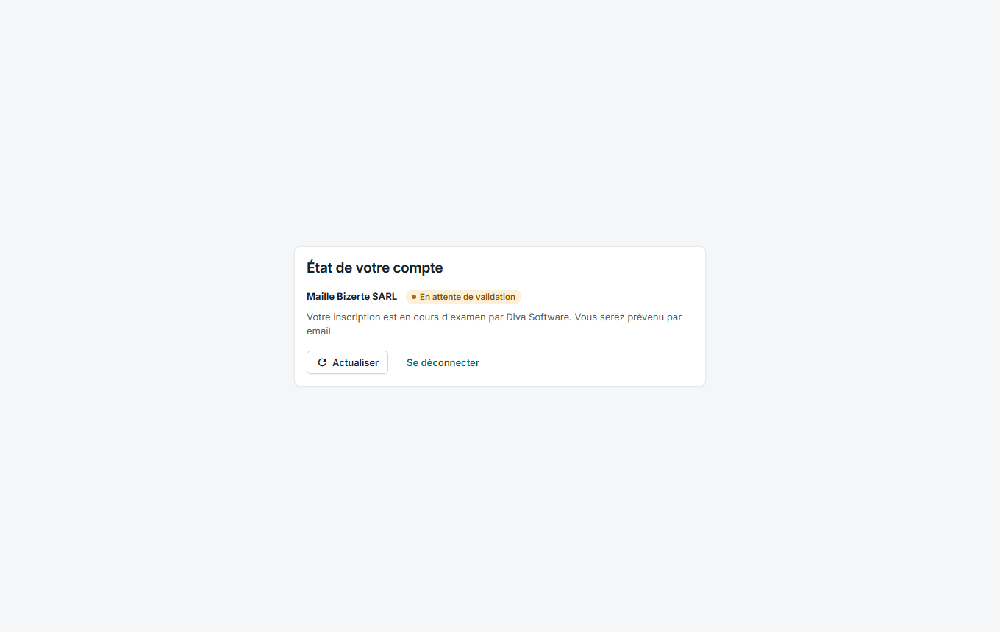

### Step 3 — you see it

The overview counter goes up and the company appears in "Inscriptions à valider" and at the top of
**Sociétés** (filter "En attente de validation").

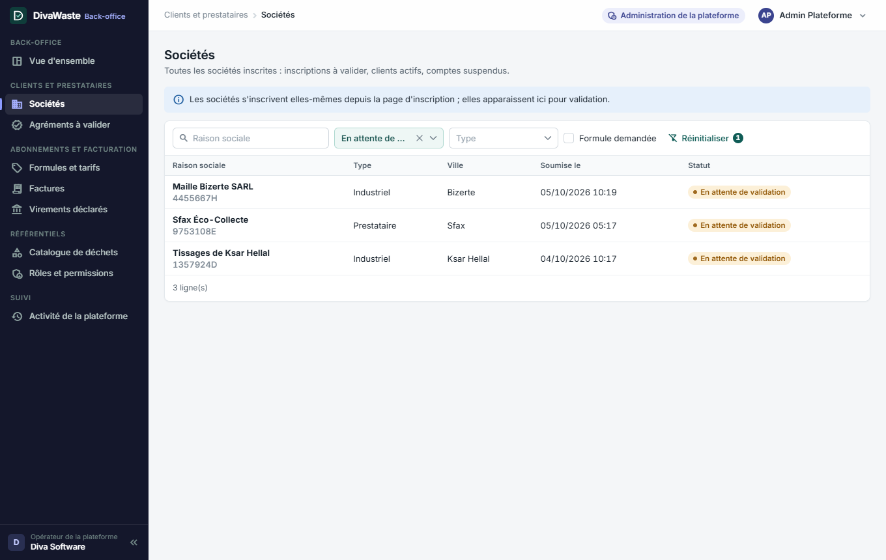

### Step 4 — you inspect the applicant

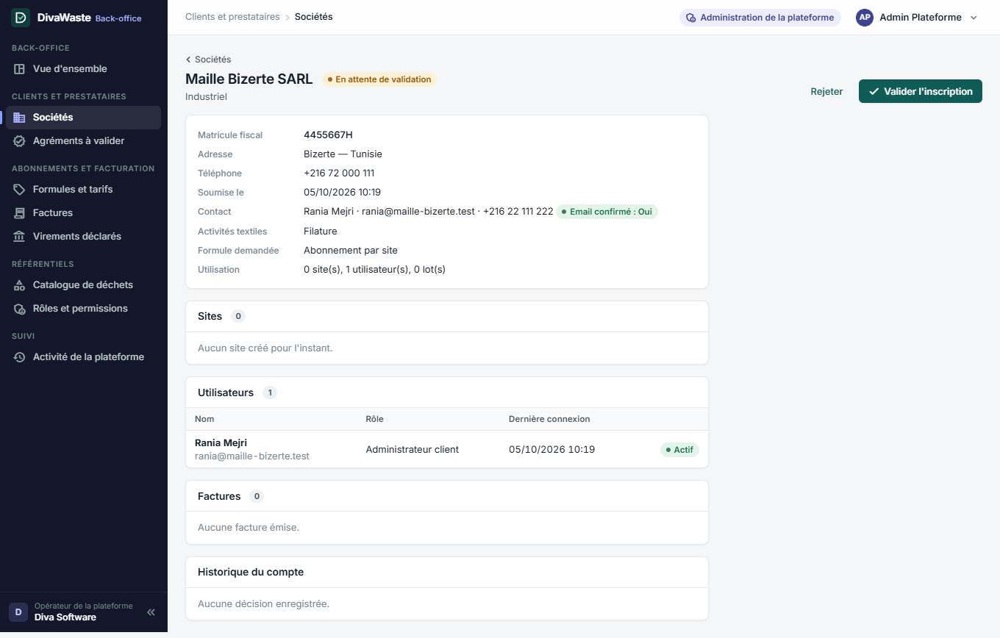

Check: the tax identifier, that the contact's email is confirmed, the declared activity, and for a provider the
accreditation documents (icon on each line opens the PDF).

### Step 5 — you approve

Click **Valider l'inscription**, then **Confirmer**.

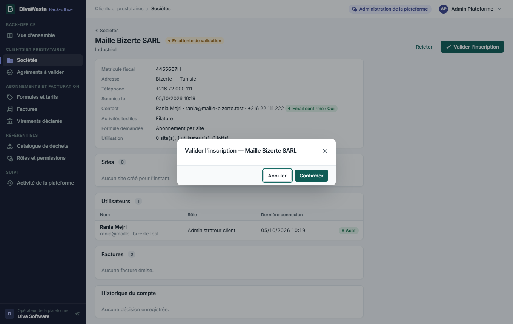

### Step 6 — what changes

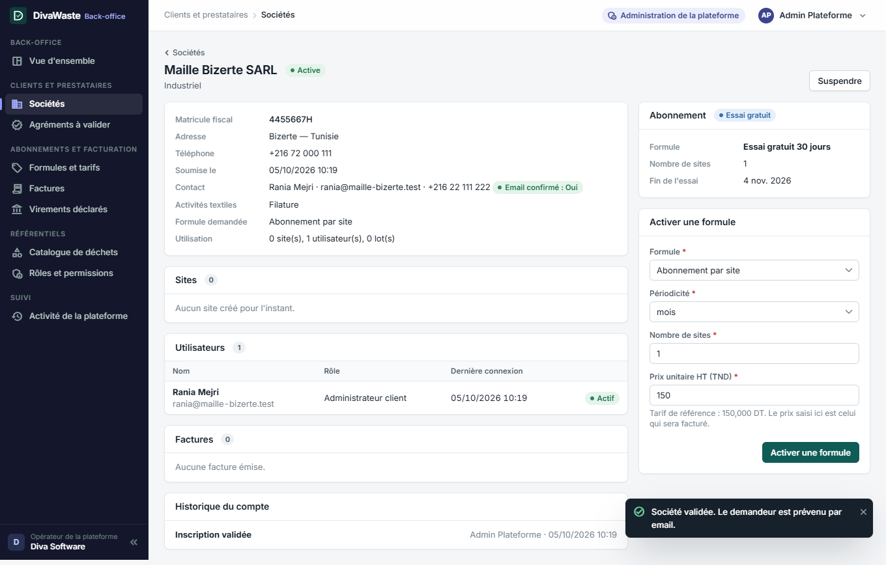

Activating the plan right away on the same page issues the first invoice; the page then shows the invoice and the
account's history:

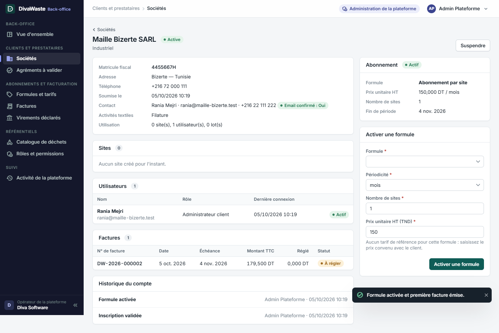

- Status becomes **Active**; the message "Société validée. Le demandeur est prévenu par email." appears.
- An industrial company gets a **30-day free trial** automatically (panel "Abonnement": *Essai gratuit*, end date).
- The applicant receives an email and an in-app notification.
- The decision is written in **Activité de la plateforme** ("Inscription validée").

### Step 7 — what the company can do

The contact signs in (or clicks "Actualiser" on the status page) and reaches the dashboard, with a banner
inviting them to finish the set-up: company details, first site and zones, waste types, team.

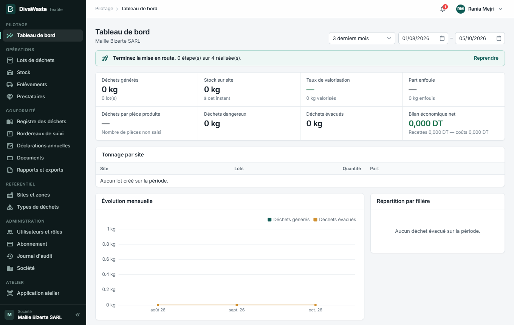
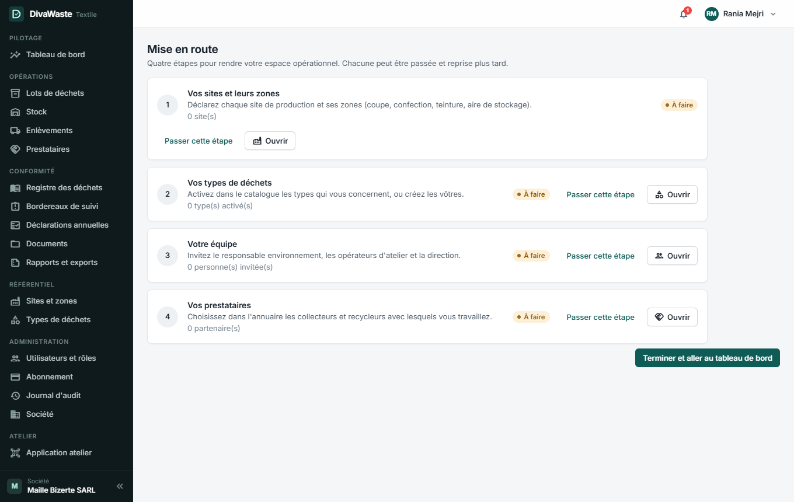

### Step 8 — the plan

During the trial nothing is invoiced. When the client is ready to pay, activate its plan: see
[section 8](#8-formules-prices-invoices-and-payments).

## 5. Rejecting a registration

Open the pending company, click **Rejeter**, type the reason (it is sent to the applicant), **Confirmer**.

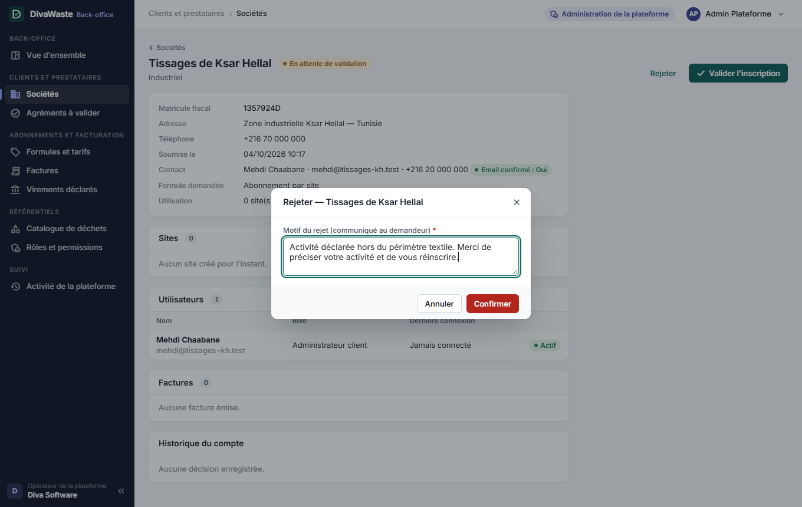
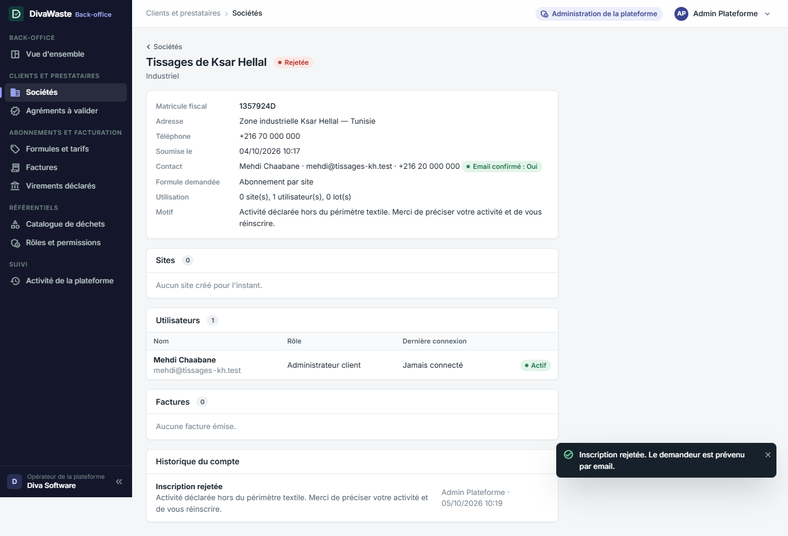

The company becomes **Rejetée**, the reason is kept on its page, the applicant receives an email, and at sign-in
sees only this:

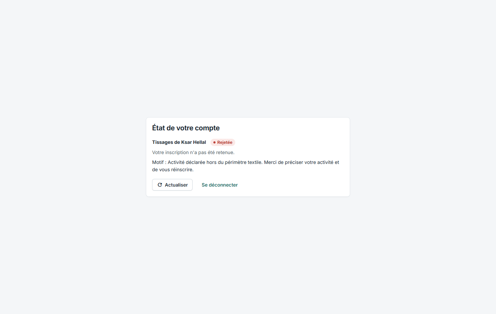

A rejected registration cannot be reopened: the company registers again with corrected information.

## 6. Suspending and reactivating a company

Open an active company, click **Suspendre**, type the reason (sent to the client), **Confirmer**.

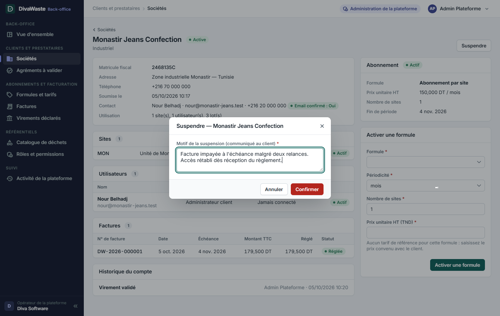
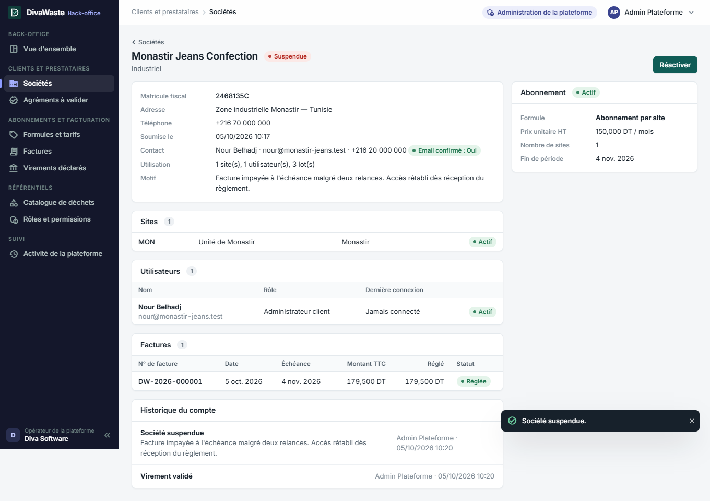

Effect, immediate for every user of that company: no screen of the application opens any more; they see the
status page with your reason. Their data is untouched.

To give access back, open the company and click **Réactiver**. Everything is as it was.

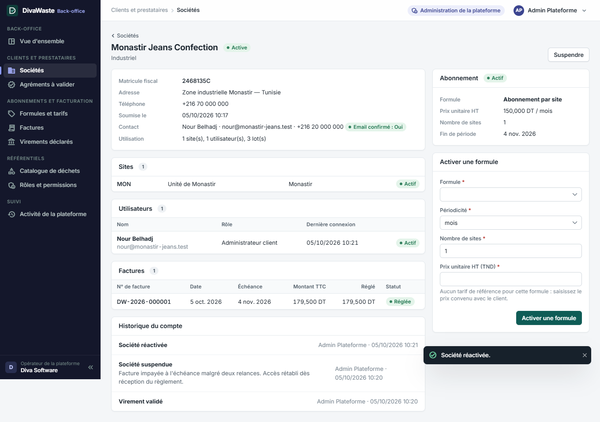

## 7. Can I create a company myself?

**No, and this is by design.** The specification (M0-01) makes companies register themselves: the person who
registers accepts the terms, proves the email address and becomes the client administrator. The platform then
approves or rejects. There is no "create company" button in the back office.

If you want to onboard a client yourself:

1. Open http://localhost:4300/register in a private window and fill the form with the client's details and the
   email of their future administrator (the country, company type and intended plan are chosen there).
2. The client clicks the confirmation link received by email.
3. You approve the company in **Sociétés**.
4. The client sets the password they chose — or uses "Mot de passe oublié" to choose their own.
5. Sites, zones and users are then created **by the client** in its workspace (`/sites`, `/admin/users`); the
   back office does not create them. The plan is activated by you (section 8).

Country configuration (currency, VAT rate, stamp duty, tax-ID format, accreditation types) is reference data
loaded by the installation; Tunisia is the only country open for sign-up. There is no screen to edit it yet
(see [Known gaps](#16-known-gaps)).

## 8. Formules, prices, invoices and payments

### How it works today — read this first

| Topic | Current behaviour |
|---|---|
| Plans | Three: **Essai gratuit 30 jours**, **Abonnement par site**, **Abonnement par volume** |
| Trial | Starts automatically when you approve an industrial company. 30 days (editable). Warnings 7 days and 1 day before the end; after the end the account is read-only |
| Price | Each paid plan has a **reference price** (monthly and yearly) that you manage. The price really invoiced is the one **you confirm when you activate the plan for a client**; it is then frozen on that client's subscription |
| Per site | Invoiced: *number of sites × unit price* per period |
| Per volume | Invoiced as a **flat amount per period**. Tonnage is **not** metered automatically in this version |
| Activation | Done by you, on the company page. It replaces the trial and issues the first invoice immediately |
| Invoice | Unit price × quantity, plus the VAT and stamp duty of the client's country (Tunisia: 19 % and 1 DT). Due in 30 days. PDF available to the client |
| Payment | Bank transfer only. The client declares the transfer; you validate it against your bank statement. Card payment is V2 |
| Renewal | Automatic, by the daily task (`subscriptions:run`), the day after a period ends |
| Change of plan | The client **asks** (plan and number of sites) from "Abonnement"; you activate it |
| Cancellation | The client cancels from "Abonnement"; the subscription stays active until the end of the paid period, then stops |
| Provisional | The price grid is Diva Software's decision: the demo values (150 DT per site per month, 400 DT per month for the volume plan) are examples. Legal texts are placeholders |

### Formules et tarifs (`/platform/plans`)

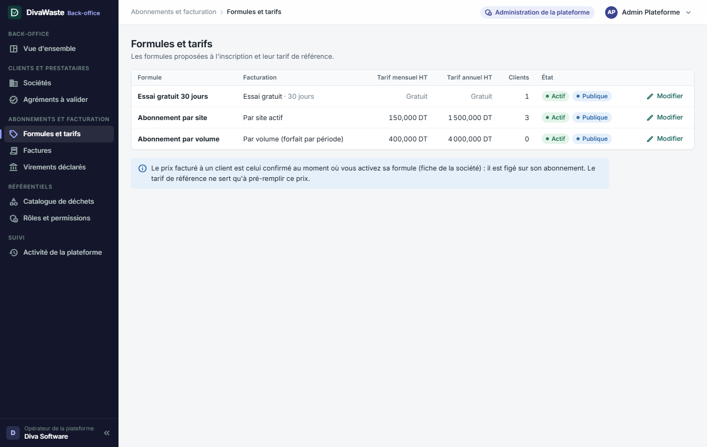

Columns: plan, billing model, monthly and yearly reference price, number of clients on it, state
(*Actif* = can be activated for a client; *Publique* = offered on the registration page).

Click **Modifier** on a line:

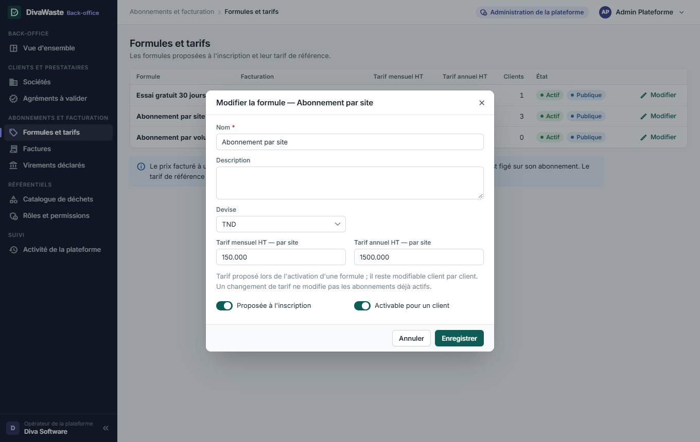

- **Nom**, **Description**.
- **Devise**, **Tarif mensuel HT**, **Tarif annuel HT**: the reference price. Changing it does not change
  subscriptions already active; the old price is closed, not overwritten.
- **Durée de l'essai** (trial plan only).
- **Proposée à l'inscription** and **Activable pour un client**.

### Activating a plan for a client

Open the company from "Formules demandées par les clients" on the overview, or click the tile
"formule(s) à activer": Sociétés opens filtered on **Formule demandée**.

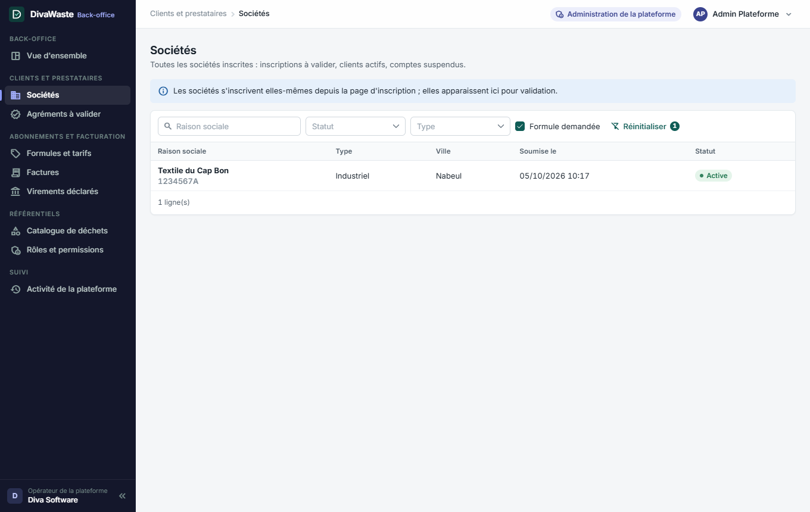

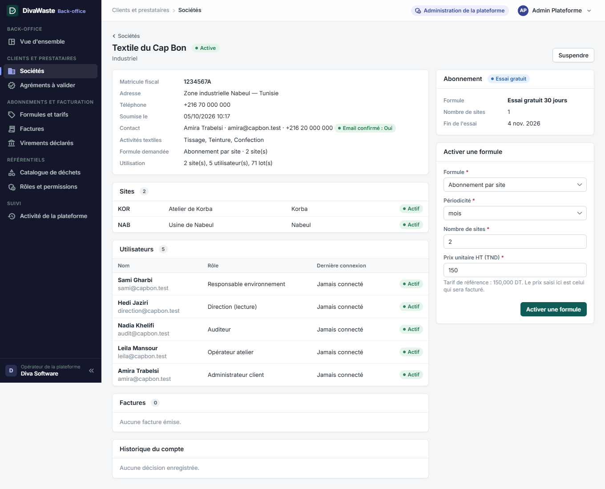

The panel **Abonnement** shows the current situation (here: free trial until 3 November). The form
**Activer une formule** is pre-filled with what the client asked ("Formule demandée") and with the reference
price; change the price if you agreed another one with this client. Click **Activer une formule**.

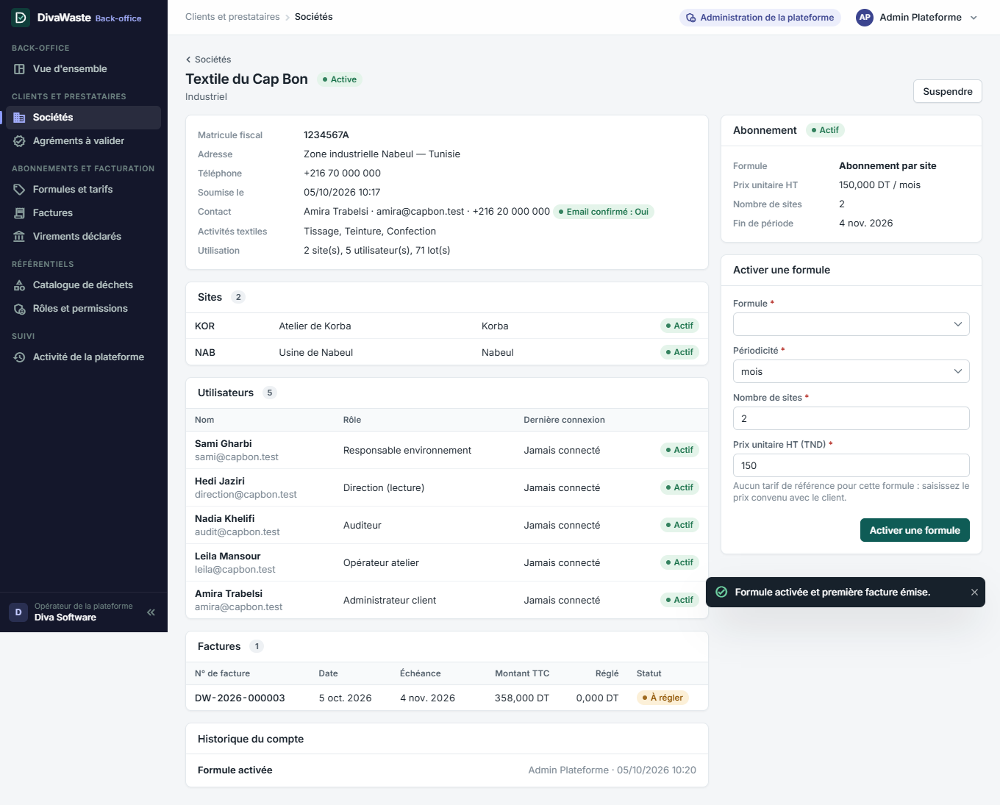

Result: the subscription is **Actif**, the unit price and number of sites are shown, the period end is set, and
the first invoice is issued (2 sites × 150 DT = 300 DT, + 57 DT VAT + 1 DT stamp duty = 358 DT). The client is
notified.

### Factures (`/platform/invoices`)

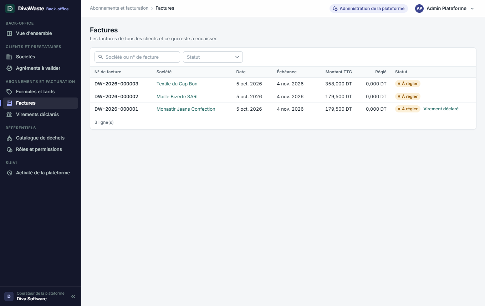

Every invoice of every client: number, company (link), issue and due dates, total, amount paid, status. Search by
company or invoice number; filter by status. "Virement déclaré" next to a status means the client says it has paid:
go to Virements déclarés.

| Status | Meaning |
|---|---|
| À régler | Issued, nothing received |
| Partiellement réglée | Part of the amount validated |
| Réglée | Fully paid |
| En retard | Past its due date |
| Annulée | Cancelled |

### Virements déclarés (`/platform/payments`)

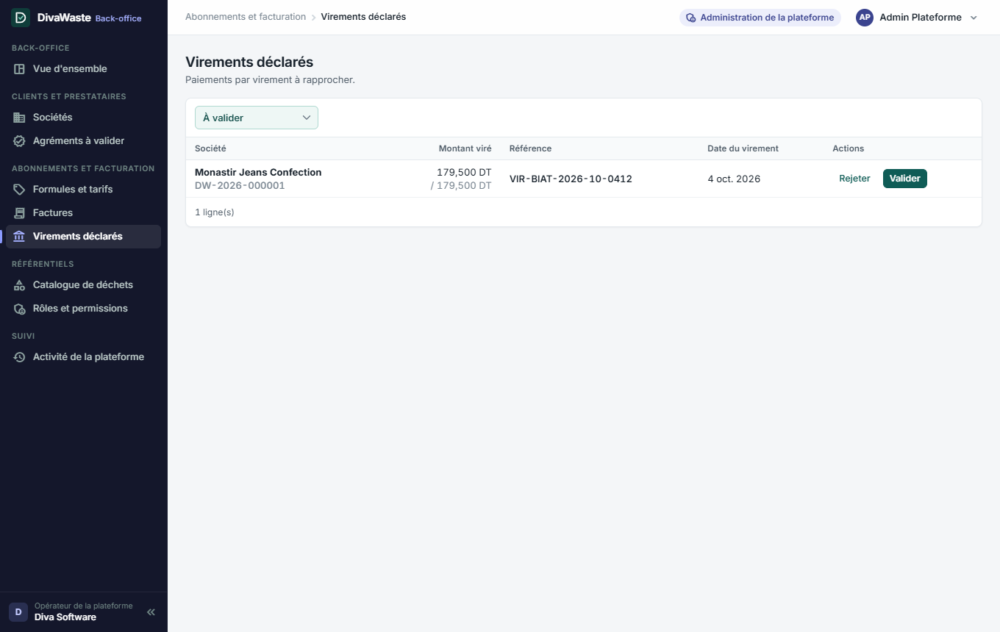

For each declared transfer: company, invoice, amount declared / invoice total, bank reference, date. Find the
transfer on your bank statement, then **Valider** (the invoice becomes "Réglée") or **Rejeter** with a reason
(the client is told and can declare again).

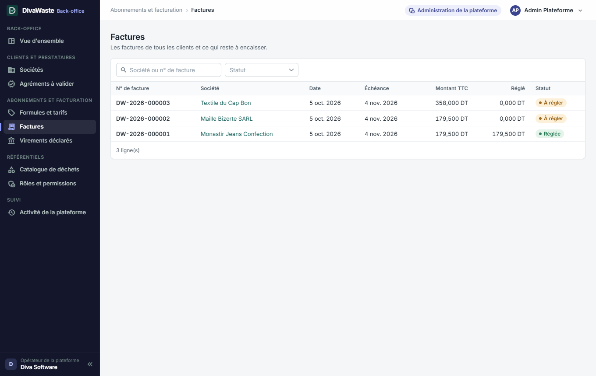

What the client sees on its side (`/admin/subscription`): the plan, the invoices and the button
"Déclarer un virement".

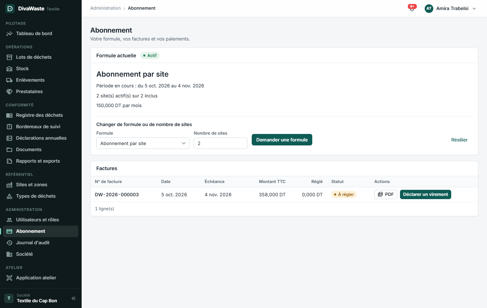
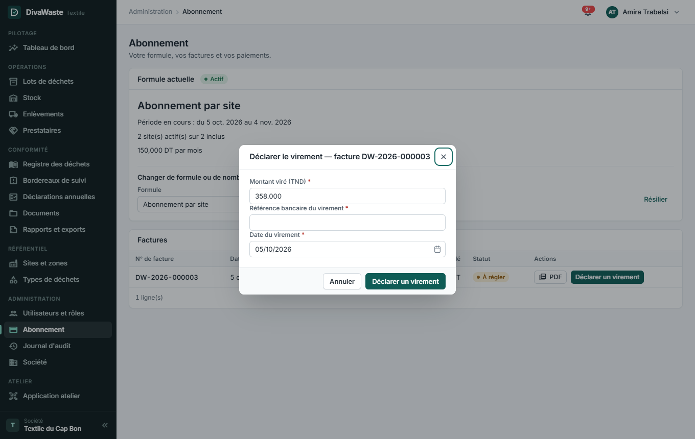

## 9. Providers and accreditations

A provider (collector, transporter, recycler, disposer) registers on the same page, choosing **Prestataire**, and
must attach at least one accreditation PDF. Two separate decisions are yours:

1. **The company** — approve or reject it in Sociétés, like any registration.
2. **Each accreditation** — in Agréments à valider.

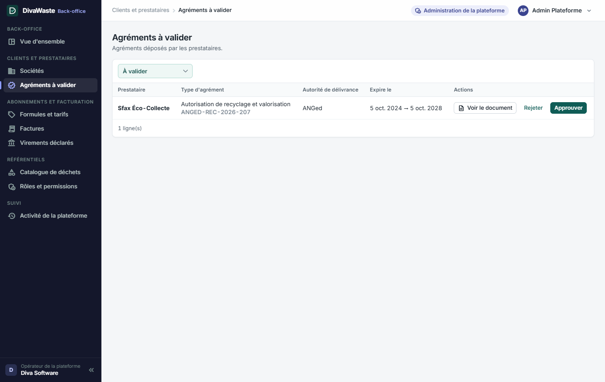

Per line: provider, type and reference of the accreditation, issuing authority, validity dates. **Voir le
document** opens the PDF. **Approuver** or **Rejeter** (with a reason).

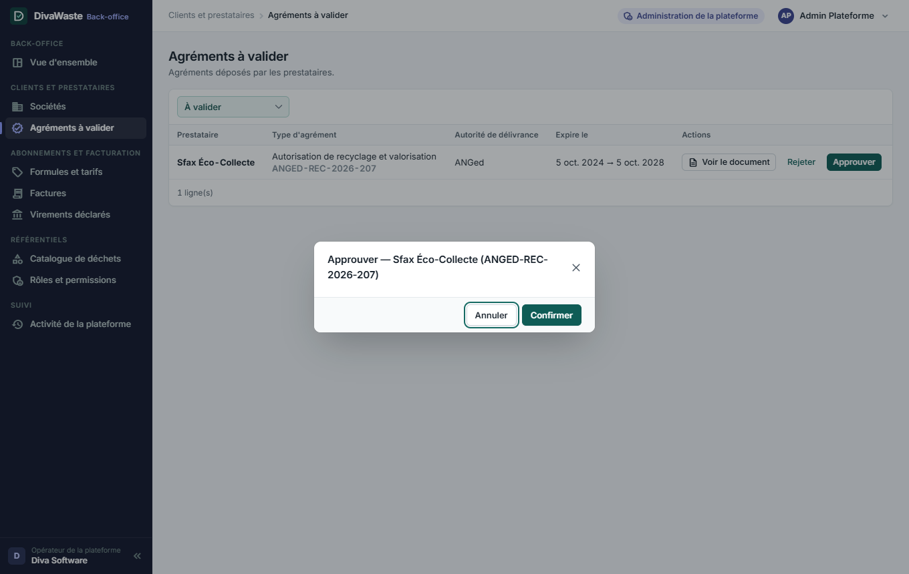
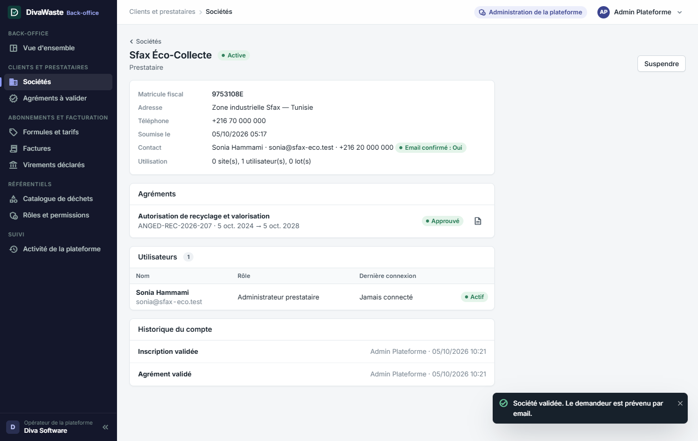

A provider adds or renews accreditations later from its own workspace; each new document comes back to this
queue. The status filter shows "À valider", "Approuvé" and "Rejeté".

**When does a provider become usable by an industrial?** When all of these are true:

- its company is **Active**;
- its profile is published in the directory (the provider does this in "Profil et déchets acceptés");
- it has at least one **approved accreditation that has not expired** — and, for hazardous waste, an approved
  hazardous-waste accreditation.

**Expiry.** 30 days before an accreditation ends the provider and its partner clients are warned (daily task
`accreditations:alert`). Once expired, the provider stays visible in the directory with the notice "Ne peut pas
être choisi pour un enlèvement — Agrément expiré ou absent", and cannot be selected in a pickup request:

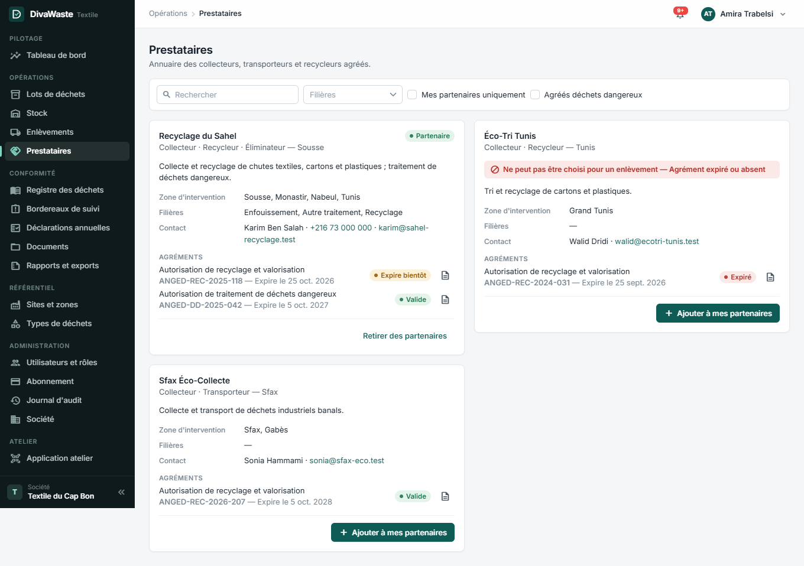

## 10. Reference waste catalogue

**Platform reference catalogue → the client activates types → the client uses them in lots.**

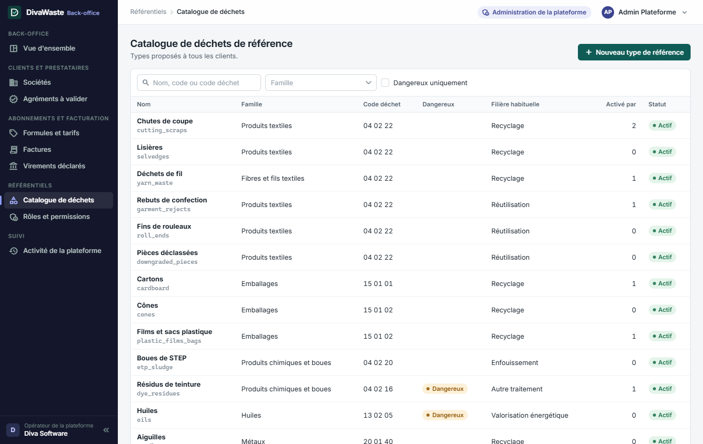

Columns: name and code, family, regulatory waste code, hazardous flag, usual treatment channel, number of
companies that activated it ("Activé par"), state. Search by name, code or waste code; filter by family or
"Dangereux uniquement".

**Create** with "Nouveau type de référence", or click a line to **edit**:

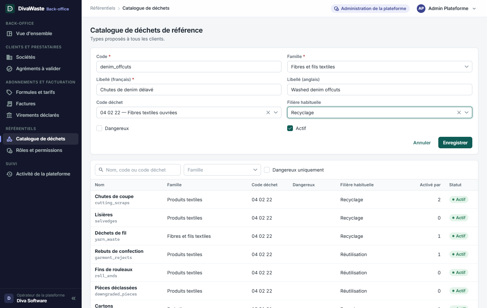

| Field | Notes |
|---|---|
| Code | Lower-case identifier, cannot change after creation (clients' types point to it) |
| Famille | Textile products, textile fibres, packaging, chemicals and sludge, oils, metals… |
| Libellé (français / anglais) | The name clients see |
| Code déchet | Regulatory code (e.g. 04 02 22). A `*` marks hazardous codes |
| Filière habituelle | Default treatment channel proposed |
| Dangereux | Hazardous waste: triggers the tracking slip and restricts the providers that can take it |
| Actif | An item in use is deactivated, never deleted |

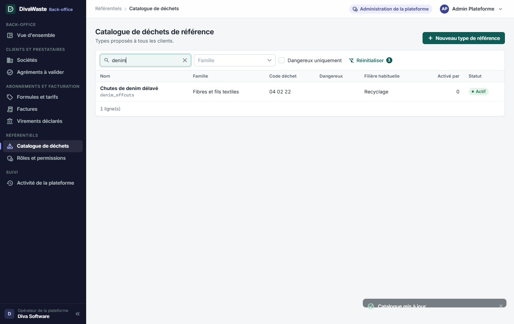

Unit (kg by default), packaging, colour, composition and unit weight are **not** set here: they belong to the
client's own type, which starts from the reference item and can be adjusted.

**What the client sees** (`/waste-types`, tab "Catalogue de référence"): every active reference item with
**Activer**. Activating creates the client's own type, which then appears in "Mes types" and in the lot forms.
A client can also create a fully custom type ("Type personnalisé").

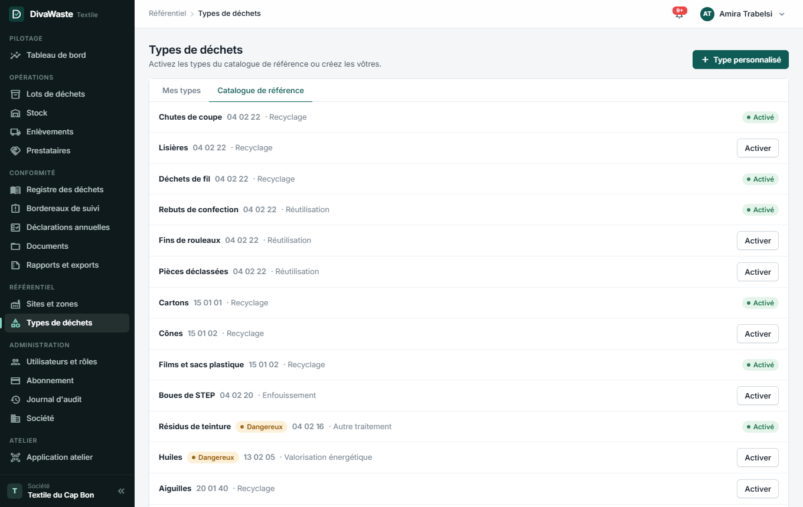
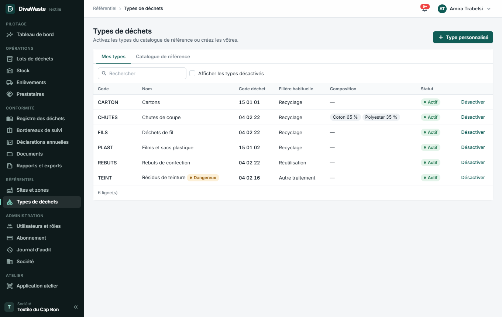

## 11. Rôles et permissions

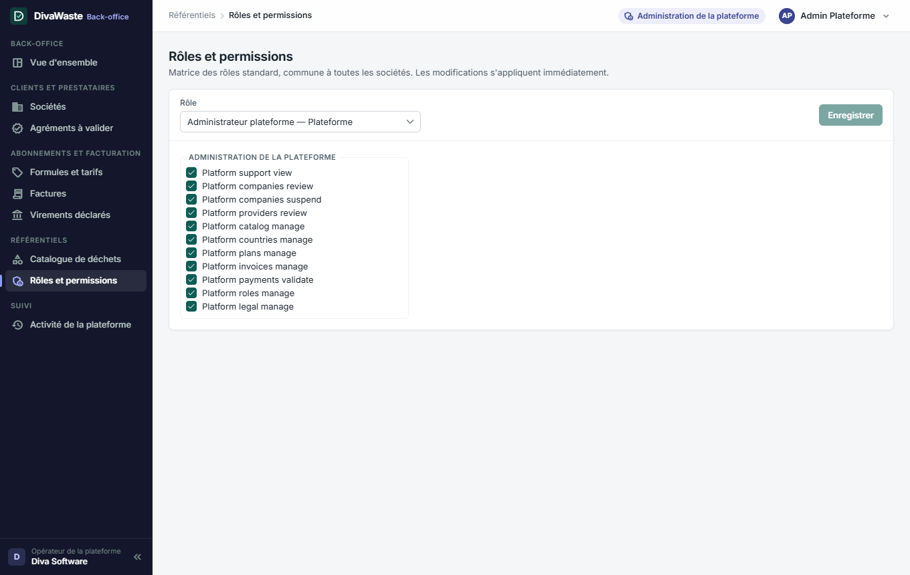

Choose a role, tick or untick permissions, **Enregistrer**. The change applies immediately to every company. Use
with care; the default matrix is described in [ROLES_AND_PERMISSIONS.md](ROLES_AND_PERMISSIONS.md). Clients can
also create their own additional roles in their workspace.

## 12. Activité de la plateforme

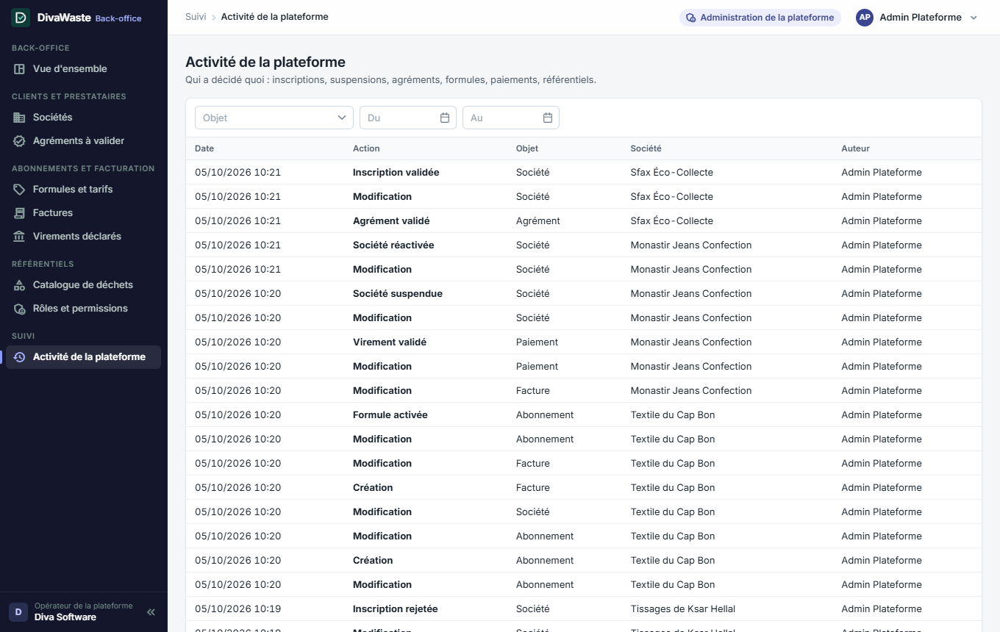

Every decision and change that concerns the platform: registrations approved or rejected, suspensions,
accreditations, plans activated, invoices, payments, catalogue and role changes — with date, company and author.
Filter by object and by date. Click a line to see the values before and after:

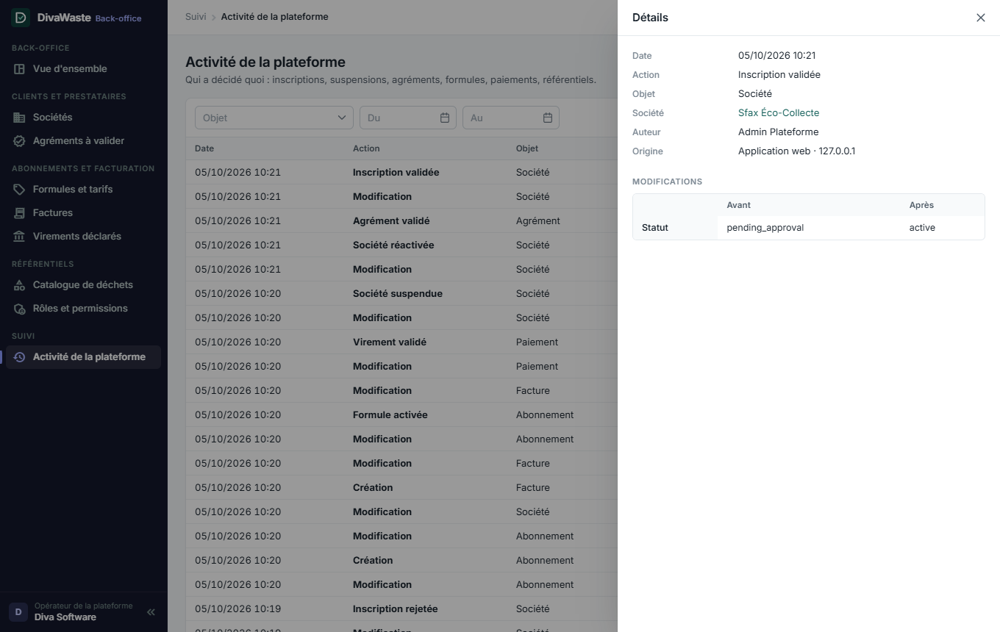

Operational data of a client (lots, pickups, documents) is **not** in this journal: it is in the client's own
"Journal d'audit".

## 13. Notifications and emails

| Event | Who is told | How |
|---|---|---|
| Company registered and email confirmed | You | Counter and list on the overview |
| Registration approved / rejected | The applicant | Email + in-app notification |
| Company suspended / reactivated | The client's administrators | Email |
| Plan requested by a client | You | "Formules demandées" on the overview |
| Invoice issued | The client | Email + notification |
| Transfer declared | You | "virement(s) à rapprocher" on the overview |
| Transfer validated / rejected | The client | Email + notification |
| Accreditation uploaded | You | "agrément(s) à valider" on the overview |
| Accreditation approved / rejected / expiring | The provider (and partner clients for expiry) | Email + notification |

In the demo environment no email is really sent: `scripts\demo.ps1 mail` prints the latest links.

## 14. What you can and cannot access

| You can | You cannot |
|---|---|
| See every company, its contact, its usage counters | Open a client's lots, pickups, stock, register or documents |
| Approve, reject, suspend, reactivate | Sign in as a client ("impersonation" does not exist) |
| Manage plans, reference prices, activate a plan, validate payments | Create a company, a site or a user for a client |
| Review accreditations and open their PDF | Edit a client's data |
| Manage the reference catalogue and the role matrix | Delete a company (regulated data is never deleted) |
| Read the platform activity | Edit countries, taxes or legal texts from the screen (not built yet) |

A second platform role exists, *Support plateforme*, which can only read the platform activity.

## 15. Daily and monthly routine

**Every day**

1. Open **Vue d'ensemble**.
2. Process "inscription(s) à valider": open, check, approve or reject.
3. Process "agrément(s) à valider": open the PDF, approve or reject.
4. Process "virement(s) à rapprocher" against the bank statement.
5. Process "formule(s) à activer": agree the price with the client, activate.

**Every month**

1. **Factures**, filter "En retard": chase, and suspend if needed (with the reason).
2. Overview: "Agréments expirant" — providers have been warned automatically; nothing to do unless one expires.
3. **Activité de la plateforme**: review the month.

The server must run the scheduler for renewals, trial warnings and accreditation alerts
(see [OPERATIONS.md](OPERATIONS.md)); in the demo run `scripts\demo.ps1 scheduler` by hand.

## 16. Known gaps

| Gap | Impact | Status |
|---|---|---|
| No screen to edit countries, VAT, stamp duty, accreditation types | Reference data is changed by a developer | To build before opening a second country |
| No screen to publish the legal documents | Texts are placeholders (`0.1-provisoire`) | Diva Software must supply the texts |
| Per-volume plan is a flat fee | Tonnage is not metered or invoiced by the tonne | Decide the price grid first (M0-03) |
| No notification bell in the back office | You rely on the overview counters | Minor |
| No suspension from the invoices list | Suspend from the company page | Minor |
| No admin creation of a company | Use the registration page (section 7) | By design |
| Card payment, SSO | Not available | V2 |
